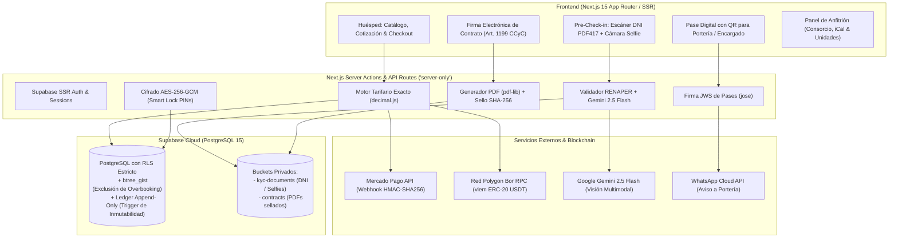
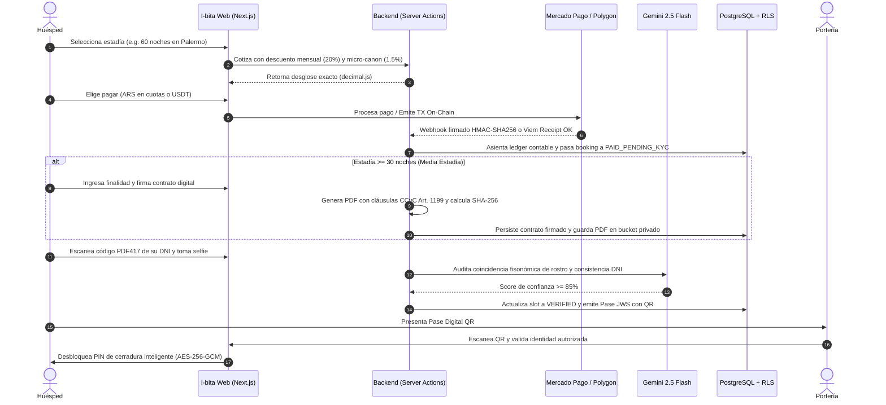

# 🇦🇷 I-bita — Plataforma Bi-Monetaria y Consorcio-Friendly de Alquileres en Argentina

> **Fintech + PropTech + Travel** para alquileres temporarios y de media estadía (1 a 6 meses) en Argentina.
> Eliminación de percepciones del dólar tarjeta con pagos en **ARS (3 y 6 Cuotas vía Mercado Pago)** o **USDT (Polygon Escrow)**, pacificación de edificios con **Pre-Check-in Biométrico Zero-Trust** y **Contratos Temporarios Digitales (Art. 1199 CCyC)** sellados criptográficamente.

[](https://github.com/hola596/I-bita/actions)
[](https://www.typescriptlang.org/)
[](https://nextjs.org/)
[](https://supabase.com/)
[](LICENSE)

---

## 📌 Los 3 Pilares Arquitectónicos

1. **Motor Bi-Monetario Nativo (`decimal.js`):**
   * **ARS:** Cobros con el SDK oficial de **Mercado Pago** en cuotas, conciliados mediante webhook validado con **HMAC-SHA256** (`x-signature` + `timingSafeEqual`).
   * **Cripto/EVM:** Checkout en **USDT sobre Polygon** verificado directamente en la blockchain con **`viem`** (`getTransactionReceipt` + decodificación de logs de transferencia `ERC-20`), prevención de doble gasto (HTTP 409) y ledger contable inmutable.

2. **Módulo "Consorcio Friendly" (Zero-Trust):**
   * **Pre-Check-in Digital:** Escaneo del código de barras **PDF417 del DNI argentino** vía `@zxing` + selfie facial auditada con **Gemini 2.5 Flash** (cumplimiento Ley 25.326 de Protección de Datos Personales).
   * **Pase Digital de Portería:** Token **JWS firmado con `jose`** y expuesto vía QR para que el encargado/seguridad valide el ingreso sin acceder a datos sensibles.
   * **Cerradura Inteligente:** Códigos de acceso cifrados en reposo mediante **AES-256-GCM con AAD** (Authenticated Additional Data).

3. **Contratos Temporarios Digitales (CCyC Art. 1199):**
   * En estadías de 30 a 180 noches, generación automática de contratos de locación temporaria en servidor con **`pdf-lib`**.
   * Sellado de integridad con **SHA-256**, firma electrónica de ambas partes y almacenamiento en bucket privado de Supabase con URLs prefirmadas temporales.
   * Comisión reducida del 6% y micro-canon voluntario para el consorcio (1%–2%).

---

## 🏗️ Diagrama de Arquitectura del Sistema



---

## 🔄 Flujo Completo de la Experiencia (User Journey)



---

## 🛠️ Stack Tecnológico

| Capa | Tecnologías | Propósito |
| :--- | :--- | :--- |
| **Framework Full-Stack** | Next.js 15.2 (App Router), React 19, TypeScript 5 | Server Components, Server Actions (`server-only`), SSR |
| **Estilos & UI** | Tailwind CSS v4, Lucide Icons, Plus Jakarta Sans | Diseño Mobile-First, WCAG 2.1 AAA, Dark/Light Mode nativo |
| **Base de Datos & Auth** | Supabase Cloud (PostgreSQL 15), Supabase SSR | Row Level Security (RLS), extensión `btree_gist`, Storage |
| **Precisión Financiera** | `decimal.js` | Cálculos monetarios sin desbordes de coma flotante |
| **Pagos en Pesos (ARS)** | SDK Oficial de Mercado Pago, Crypto HMAC-SHA256 | Checkout con cuotas, Webhooks con validación segura de firma |
| **Pagos en Cripto (USDT)** | `viem` | Interacción RPC con Polygon, decodificación de logs ERC-20 |
| **Visión por Computadora & IA** | `@google/generative-ai` (Gemini 2.5 Flash), `@zxing` | Auditoría biométrica facial y decodificación de DNI PDF417 |
| **Criptografía & Seguridad** | `node:crypto` (AES-256-GCM), `jose` (JWS), SHA-256 | Cifrado Zero-Trust de cerraduras y firmado de pases QR |
| **Generación Documental** | `pdf-lib` | Renderizado de contratos legales CCyC en servidor |
| **Sincronización de Calendarios** | `node-ical`, `ical-generator`, `ssrf-req-filter` | Protección SSRF contra redes privadas (RFC 1918) |

---

## 🚀 Guía de Inicio Rápido (Local Development)

### 1. Requisitos Previos
* **Node.js:** Versión `>= 20.0.0` (recomendado v22 o v24).
* **NPM:** `>= 10.0.0`.
* Una instancia de **Supabase Cloud** (o PostgreSQL 15 con extensiones `uuid-ossp` y `btree_gist`).

### 2. Clonar e Instalar Dependencias
```bash
git clone https://github.com/hola596/I-bita.git
cd I-bita
npm install
```

### 3. Configurar Variables de Entorno
Copiá el archivo de plantilla `.env.example` a `.env.local`:
```bash
cp .env.example .env.local
```
Completá las variables clave en `.env.local`:
* `NEXT_PUBLIC_SUPABASE_URL`, `NEXT_PUBLIC_SUPABASE_ANON_KEY`, `SUPABASE_SERVICE_ROLE_KEY`, `DATABASE_URL`.
* `ACCESS_CODE_ENCRYPTION_KEY`: Clave hex de 32 bytes (`node -e "console.log(require('crypto').randomBytes(32).toString('hex'))"`).
* `GEMINI_API_KEY`: API key de Google AI Studio.
* `PORTERIA_JWS_SECRET`: Clave base64url de 32 bytes (`node -e "console.log(require('crypto').randomBytes(32).toString('base64url'))"`).
* `MP_ACCESS_TOKEN`, `NEXT_PUBLIC_MP_PUBLIC_KEY`, `MP_WEBHOOK_SECRET`: Credenciales de Sandbox de Mercado Pago.
* `EVM_RPC_URL`: Endpoint RPC de Polygon (e.g. `https://polygon-bor-rpc.publicnode.com`).

### 4. Aplicar Migraciones de Base de Datos
Ejecutá el script de migración que crea las 10 tablas, tipos ENUM, triggers de inmutabilidad y políticas RLS:
```bash
npm run db:migrate
```

### 5. Sembrar Datos de Prueba (Demo Seeding)
Cargá la propiedad de prueba en Palermo Soho, perfiles de demostración y reservas activas:
```bash
npm run seed:demo
```

### 6. Iniciar Servidor de Desarrollo
```bash
npm run dev
```
Abrí tu navegador en **`http://localhost:3000`**.

---

## 🧪 Verification Gates & Calidad de Código

El repositorio implementa puertas de calidad automatizadas ("Verification Gates") que auditan cada subsistema crítico:

```bash
# Comprobación de tipos TypeScript (estricto)
npm run typecheck

# Gate 1: Extensiones PostgreSQL, btree_gist y anti-overbooking
npm run gate:1

# Gate 2: Sincronización iCal con firewall SSRF anti-intranet
npm run gate:2

# Gate 3: Biometría Zero-Trust, escáner PDF417 y Pase de Portería JWS
npm run gate:3

# Gate 4.1: Checkout ARS con Mercado Pago SDK y Webhook HMAC-SHA256
npm run verify:4.1

# Gate 4.2: Checkout USDT Polygon con Viem On-Chain y Ledger Append-Only
npm run verify:4.2

# Gate 4.3: Contratos Temporarios Art. 1199 CCyC con Sellado SHA-256
npm run verify:4.3
```

---

## 📂 Estructura del Proyecto

```text
├── .github/
│   └── workflows/
│       └── ci.yml               # Pipeline de Integración Continua (CI)
├── docs/                        # Arquitectura, PRD y especificaciones de historias
│   ├── architecture.md          # Arquitectura técnica integral
│   ├── prd.md                   # Requerimientos de producto
│   └── stories/                 # Especificaciones de implementación y gates
├── scripts/
│   ├── gates/                   # Scripts de verificación y testing de gates
│   ├── migrate.ts               # Runner de migraciones SQL sobre Supabase
│   └── seed-demo.ts             # Sembrador de datos para entorno demo local
├── src/
│   ├── app/                     # Next.js 15 App Router
│   │   ├── (public)/            # Páginas estáticas / legales (Términos, Privacidad, Contacto)
│   │   ├── checkin/             # Flujo de Pre-Check-in biométrico y Pase QR
│   │   ├── checkout/            # Checkout bi-monetario ARS / USDT
│   │   ├── contratos/           # Módulo de firma y descarga de contratos CCyC
│   │   ├── dashboard/           # Panel de anfitrión y administración
│   │   ├── p/[slug]/            # Microsite público de propiedad y widget de reserva
│   │   ├── layout.tsx           # Layout global con Header y Cookie Consent Banner
│   │   └── page.tsx             # Home con Hub de Pruebas Interactivo
│   ├── components/              # Componentes de UI (Client y Server Components)
│   │   ├── booking/             # Widgets de cotización y checkout cripto
│   │   ├── contracts/           # Tarjeta de firma digital y visor PDF
│   │   ├── kyc/                 # Flujo biométrico con cámara y escaneo
│   │   └── properties/          # Paneles de gestión consorcial e iCal
│   ├── lib/                     # Utilidades transversales
│   │   ├── crypto/              # AES-256-GCM, SHA-256 y firma JWS
│   │   ├── math/                # Motor tarifario Decimal.js
│   │   └── supabase/            # Clientes SSR, Server y Admin de Supabase
│   ├── modules/                 # Lógica de dominio y Server Actions
│   │   ├── consortium/          # Validaciones consorciales y biometría
│   │   ├── contracts/           # Generación de contratos y hash SHA-256
│   │   ├── payments/            # Mercado Pago SDK y Viem Polygon
│   │   └── properties/          # Consultas públicas seguras (Zero-Trust)
│   └── env.ts                   # Validación Fail-Fast de variables de entorno (T3 Env)
├── supabase/
│   └── migrations/              # Definiciones SQL DDL, ENUMs y RLS
├── CONTRIBUTING.md               # Guía de contribución para desarrolladores
├── LICENSE                      # Licencia de código abierto MIT
└── README.md                    # Esta documentación
```

---

## 🔒 Seguridad y Cumplimiento Normativo

* **Ley 25.326 de Protección de Datos Personales (Argentina):**  
  Las imágenes biométricas y fotos de DNI se alojan exclusivamente en buckets privados con políticas RLS de acceso restringido. El consentimiento explícito se registra con timestamp inmutable.
* **Código Civil y Comercial de la Nación (Art. 1199):**  
  Los contratos de locación temporaria incluyen finalidad expresa (turismo, estudio, descanso), cláusulas de convivencia consorcial y hash criptográfico SHA-256 inviolable.
* **OWASP & Ciberseguridad Defensiva:**  
  Protección activa contra inyecciones SQL (PostgreSQL parametrizado), SSRF (filtro de IPs privadas en iCal mediante `ipaddr.js` y `ssrf-req-filter`), suplantación de identidad (HMAC-SHA256 con comparación en tiempo constante) y ataques de sobre-reserva (`EXCLUDE USING gist`).

---

## 👥 Contribuir al Proyecto

¡Las contribuciones son bienvenidas! Por favor consultá la [Guía de Contribución](CONTRIBUTING.md) antes de enviar un Pull Request.

---

## 📄 Licencia

Este proyecto se distribuye bajo la licencia **MIT**. Consultá el archivo [LICENSE](LICENSE) para más información.
