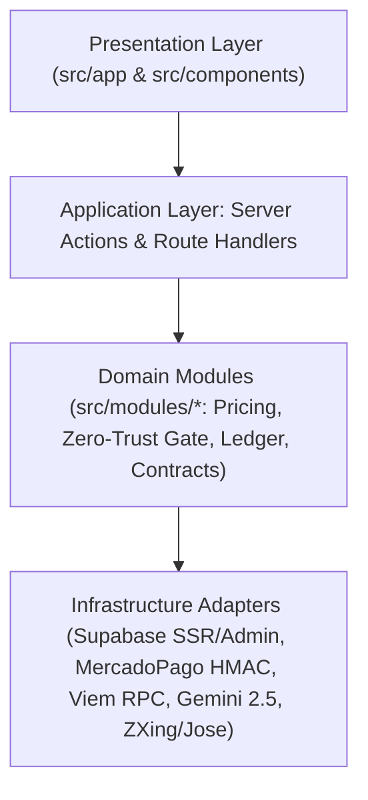

# Architecture Spine — I-bita

## Design Paradigm

**Clean Modular Monolith with Hexagonal Ports & Adapters** ejecutado de forma 100% Cloud-Native sobre **Next.js App Router (`src/app`)**, módulos de dominio aislados (`src/modules/{auth,properties,ical,consortium,payments,contracts,marketplace}`) y persistencia/seguridad delegada a **Supabase Cloud (`trknmgnzjhrhtwloiaga`)**. Ningún componente de UI (`src/components` o `src/app`) accede directamente a SDKs externos (`mercadopago`, `viem`, `@google/generative-ai`, `node-ical`); toda integración pasa por el puerto de servidor de su módulo.



## Invariants & Rules

### AD-1 — Low-Footprint Cloud-Native Execution `[ADOPTED]`

- **Binds:** `all`, `NFR-2`
- **Prevents:** Saturación de RAM/CPU/Disco en el entorno local Intel Core i5 por contenedores Docker pesados o modelos locales.
- **Rule:** Prohibido levantar servicios Docker pesados locales (PostgreSQL local, Redis local, OCR/LLM local). Toda persistencia, autenticación y almacenamiento opera contra Supabase Cloud (`trknmgnzjhrhtwloiaga`) y las inferencias multimodales contra Gemini 2.5 Flash API.

### AD-2 — Fail-Fast Environment Contract `[ADOPTED]`

- **Binds:** `all`, `NFR-3`, `NFR-5`
- **Prevents:** Uso de fallbacks silenciosos (`process.env.KEY || "mock"`) o arranque con credenciales faltantes.
- **Rule:** Prohibido leer `process.env` directamente fuera de `src/env.ts`. Todo módulo importa `env` desde `src/env.ts`, validado en tiempo de build y arranque mediante `@t3-oss/env-nextjs` y `zod`.

### AD-3 — Database-Enforced Anti-Double-Booking (`btree_gist`) `[ADOPTED]`

- **Binds:** `FR-4`, `FR-5`, `NFR-6`
- **Prevents:** Condiciones de carrera (*race conditions*) que permitan dos reservas superpuestas para la misma unidad funcional entre el checkout web y la sincronización iCal.
- **Rule:** La tabla `public.bookings` lleva la restricción física `EXCLUDE USING gist (property_id WITH =, daterange(check_in, check_out, '[)') WITH &&) WHERE (status NOT IN ('CANCELLED', 'EXPIRED'))`. Todo bloqueo de calendario externo (`iCal`) se registra con la misma garantía de exclusión.

### AD-4 — SSRF Shield on External Calendar Ingestion `[ADOPTED]`

- **Binds:** `FR-5`, `NFR-3`
- **Prevents:** Ataques de Server-Side Request Forgery (SSRF) contra metadatos cloud (`169.254.169.254`) o redes privadas (`127.0.0.0/8`, `10.0.0.0/8`, `192.168.0.0/16`, `localhost`) a través de URLs `.ics` provistas por usuarios.
- **Rule:** Antes de invocar `node-ical`, el adaptador `src/modules/ical/ssrf-guard.ts` resuelve el DNS y valida la IP con `ipaddr.js` / `ssrf-req-filter`, abortando con `SSRFBlockedError (HTTP 422)` cualquier IP no pública o protocolo distinto de `https:`.

### AD-5 — Cryptographic Zero-Trust Consorcial Gate `[ADOPTED]`

- **Binds:** `FR-8`, `FR-9`, `FR-10`, `FR-11`, `NFR-4`
- **Prevents:** Exposición prematura del código de cerradura en payloads de red o su ocultamiento inseguro mediante CSS (`display: none` / `blur`).
- **Rule:** El código de ingreso se almacena cifrado con `AES-256-GCM` (`node:crypto` con `ACCESS_CODE_ENCRYPTION_KEY`) en `properties.access_code_ciphertext`. Ningún `SELECT` general expone el PIN; únicamente la acción de servidor `revealPropertyAccessCode(bookingId)` desencripta el valor tras verificar en PostgreSQL que `declared_adults_count == verified_adults_count` y `status == 'ALL_ADULTS_VERIFIED'`, disparando en la misma transacción el Pase Digital de Portería firmado con `jose` (`HS256`).

### AD-6 — Webhook/RPC-Only Financial Mutation & Immutable Double-Entry Ledger `[ADOPTED]`

- **Binds:** `FR-7`, `FR-12`, `FR-13`, `FR-14`, `FR-15`, `FR-16`, `NFR-7`
- **Prevents:** Marcado falso de reservas como pagadas desde el frontend (`?status=approved`), alteración histórica de saldos o errores de redondeo de punto flotante en comisiones y splits.
- **Rule:** Ningún endpoint de cliente puede mutar `bookings.payment_status` ni insertar en `public.ledger_entries`. Solo `POST /api/webhooks/payments` (tras verificar HMAC-SHA256 con `MP_WEBHOOK_SECRET` para ARS o recibo de bloque confirmado con `viem` para USDT) escribe en `ledger_entries` usando `SUPABASE_SERVICE_ROLE_KEY` y clave de idempotencia (`idempotency_key UNIQUE`). `ledger_entries` tiene bloqueados `UPDATE` y `DELETE` mediante trigger y RLS. Todo cálculo monetario usa `decimal.js`.

## Consistency Conventions

| Concern | Convention |
| --- | --- |
| Naming (entities, files, interfaces, events) | Tablas y columnas SQL en `snake_case`; archivos TypeScript en `kebab-case.ts`; componentes React en `PascalCase.tsx`; esquemas Zod con sufijo `*Schema`. |
| Data & formats (ids, dates, error shapes, envelopes) | IDs primarios en `UUID v4`; fechas de check-in/out en `DATE` (`YYYY-MM-DD`, zona `America/Argentina/Buenos_Aires`); timestamps en `TIMESTAMPTZ` (ISO 8601 UTC); montos en `NUMERIC(18,6)` en DB y `Decimal` (`decimal.js`) en memoria; respuestas de Server Actions/API con sobre `{ ok: boolean, data?: T, error?: { code: string, message: string, details?: unknown } }`. |
| State & cross-cutting (mutation, errors, logging, config, auth) | Autenticación vía `@supabase/ssr` con cookies `HttpOnly`; errores de dominio tipados (`AppError`); prohibido `mock`, `dummy`, `setTimeout` o datos hardcodeados (Zero-Simulation Policy). |

## Stack

| Name | Version |
| --- | --- |
| Node.js | `>=24.15.0` |
| TypeScript | `^5.8.0` |
| Next.js (App Router) | `^15.2.0` |
| React | `^19.0.0` |
| Tailwind CSS | `^4.0.0` |
| Supabase (`@supabase/supabase-js` & `@supabase/ssr`) | `^2.49.0` / `^0.6.0` |
| Env Validation (`@t3-oss/env-nextjs` + `zod`) | `^0.12.0` / `^3.24.0` |
| Calendar Sync (`node-ical` + `ical-generator`) | `^0.20.0` / `^8.1.0` |
| Anti-SSRF (`ipaddr.js` + `ssrf-req-filter`) | `^2.2.0` / `^2.0.0` |
| DNI PDF417 Scanner (`@zxing/library` + `@zxing/browser`) | `^0.21.3` / `^0.1.5` |
| Biometric Multimodal AI (`@google/generative-ai`) | `^0.24.0` (Gemini 2.5 Flash) |
| Cryptographic Tokens & QR (`jose` + `qrcode`) | `^6.0.0` / `^1.5.4` |
| Payments ARS (`mercadopago`) | `^2.5.0` |
| Payments Web3 USDT (`viem`) | `^2.23.0` |
| Financial Precision (`decimal.js`) | `^10.5.0` |
| Legal PDF Contracts (`pdf-lib`) | `^1.17.1` |

## Structural Seed

```text
I-bita/
  docs/
    project-brief.md
    prd.md
    architecture.md
  supabase/
    migrations/
      0001_initial_schema_and_rls.sql
  scripts/
    gates/
      gate-epic-1-btree-gist.ts
      gate-epic-2-ical-ssrf.ts
      gate-epic-3-zero-trust-kyc.ts
      gate-epic-4-webhook-pdf-ledger.ts
      gate-epic-5-zero-simulation.ts
  src/
    env.ts
    middleware.ts
    app/
      (public)/
      (auth)/
      (dashboard)/
      p/[slug]/
      checkin/[bookingId]/
      verify/[token]/
      api/
        ical/[propertyId]/route.ts
        webhooks/payments/route.ts
    modules/
      auth/
      properties/
      ical/
      consortium/
      payments/
      contracts/
      marketplace/
    lib/
      supabase/
      crypto/
      errors/
```

## Capability → Architecture Map

| Capability / Area | Lives in | Governed by |
| --- | --- | --- |
| Auth Multi-Rol, Onboarding KYB & Legal (`FR-1`..`FR-3`) | `src/modules/auth`, `src/app/(public)/legal` | `AD-1`, `AD-2` |
| Propiedades, Precios Duales & Link Directo (`FR-4`, `FR-6`, `FR-7`) | `src/modules/properties`, `src/app/p/[slug]` | `AD-3`, `AD-5`, `AD-6` |
| Sincronización Bidireccional iCal (`FR-5`) | `src/modules/ical`, `src/app/api/ical/[propertyId]` | `AD-3`, `AD-4` |
| Consorcio Friendly, PDF417, Biometría & Pase QR (`FR-8`..`FR-11`) | `src/modules/consortium`, `src/app/checkin`, `src/app/verify` | `AD-5` |
| Checkout Bi-Monetario ARS/USDT, Ledger & Split (`FR-12`..`FR-14`) | `src/modules/payments`, `src/app/api/webhooks/payments` | `AD-6` |
| Contratos CCyC Art. 1199 PDF & Escrow (`FR-15`, `FR-16`) | `src/modules/contracts` | `AD-6` |
| Marketplace B2C, SEO/GEO JSON-LD & Reportes RPATT (`FR-17`, `FR-18`) | `src/modules/marketplace`, `src/app/(public)` | `AD-1`, `AD-3` |

## Deferred

- **Integración con APIs de hardware IoT físico (cerraduras TTLock/Yale y sensores acústicos Minut):** Diferido a Fase 2 según `PRD §6`.
- **Operación directa de cambio de bonos USD MEP vía ALyC:** Diferido a Fase 2; en MVP el Split opera sobre las monedas nativas procesadas (ARS en CBU/CVU y USDT en Polygon).
