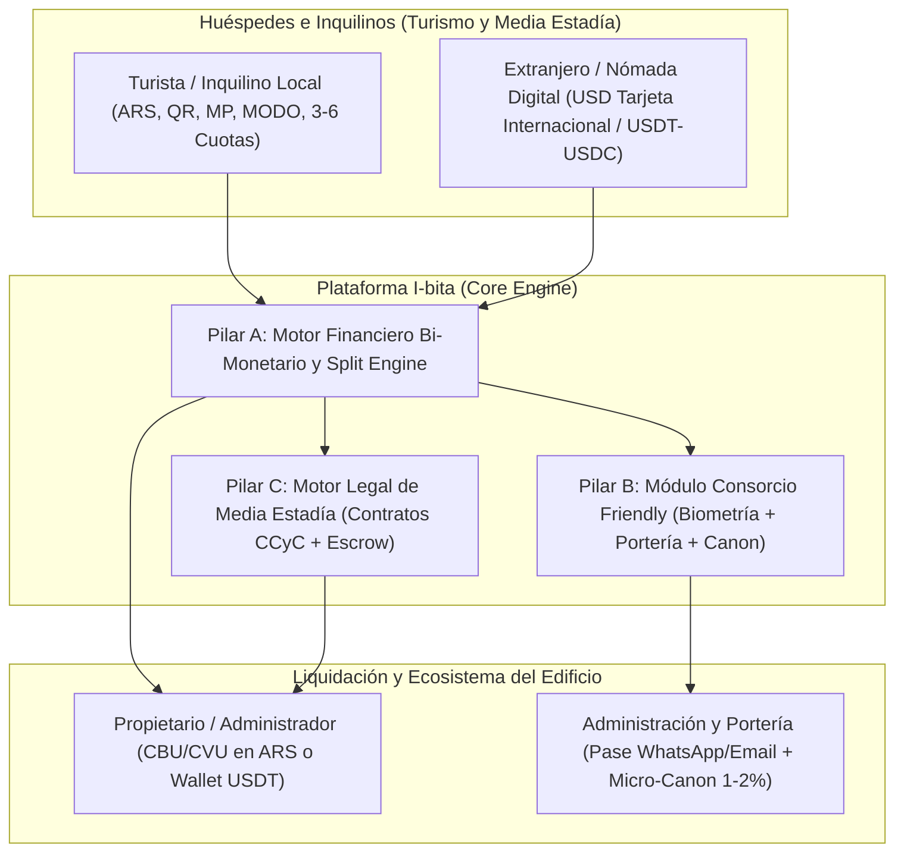

# Product Brief: I-bita
**El Ecosistema Argentino de Alquileres Temporarios y Media Estadía (Fintech + PropTech + Travel)**

---

## 1. Resumen Ejecutivo (Executive Summary)

**I-bita** es un marketplace y plataforma SaaS (B2B2C / B2C) diseñada específicamente para el mercado argentino de alquileres temporarios y de media estadía (1 a 6 meses). Mientras que plataformas globales como Airbnb o Booking aplican un modelo estandarizado internacional que choca de frente con la realidad económica, impositiva y consorcial de Argentina, **I-bita** convierte esas fricciones locales en su principal ventaja competitiva.

La propuesta de valor de I-bita se apoya en **tres pilares de innovación local**:
1. **Motor Financiero Bi-Monetario y Nativo (Fintech + Travel):** Permite a los huéspedes argentinos pagar en Pesos (ARS) mediante Mercado Pago, MODO, transferencias QR y financiación en 3 y 6 cuotas sin percepciones cambiarias; habilita a turistas extranjeros y nómadas digitales a pagar en USD o Stablecoins (USDT/USDC); y ofrece al propietario un **Split de Liquidación** automatizado para elegir cómo cobrar (ARS instantáneo en CBU/CVU, USDT en billetera virtual o conversión a USD MEP en fases evolutivas).
2. **Módulo "Consorcio Friendly":** Transforma la guerra vecinal en los edificios de propiedad horizontal en una alianza operativa y económica. Incluye pre-check-in biométrico obligatorio (RENAPER / Pasaporte) para el titular y todos sus acompañantes, envío automático de **Pase Digital de Portería** por WhatsApp/Email a la seguridad del edificio, un **Micro-Canon Consorcial** opcional (1%–2% de cada reserva destinado al fondo del consorcio para bajar expensas) e integración futura con sensores acústicos IoT de decibeles.
3. **Contratos Flexibles de Media Estadía (1 a 6 meses):** Captura el vacío post-desregulación inmobiliaria entre el alquiler turístico diario (encarecido por comisiones del 15%–20% en Airbnb) y el contrato tradicional de 2 años. Aplica una **comisión decreciente (5%–7% para estadías mayores a 30 días)**, generación automática de contratos de locación temporaria válidos bajo el Código Civil y Comercial Argentino con firma digital, y custodia de garantía (escrow) protegida contra la inflación.

Para resolver el dilema del "huevo y la gallina" sin quemar capital en adquisición prematura de tráfico, I-bita ejecuta un **Go-To-Market Híbrido Secuencial**: ingresa primero como una **capa SaaS B2B2C** para anfitriones y administradores que ya operan en Airbnb (brindándoles web de reservas directas con inventario sincronizado vía iCal, cobros locales/cripto y check-in consorcial biométrico), y consolida sobre esa oferta cautiva el **Marketplace B2C** en corredores de alta tracción nacional y corporativa.

---

## 2. El Problema (The Problem)

El mercado de alquileres temporarios y flexibles en Argentina sufre tres fracturas estructurales que las plataformas extranjeras no pueden ni tienen incentivos para resolver:

### A. Fricción Financiera, Cambiaria e Impositiva
* **Para el inquilino/turista argentino:** Reservar un alojamiento dentro de su propio país a través de Airbnb implica precios dolarizados, cobros en tarjeta de crédito sujetos a percepciones e impuestos al dólar tarjeta, e imposibilidad de pagar con medios locales cotidianos (transferencia QR, MODO, Mercado Pago) o financiar su estadía en cuotas en pesos.
* **Para el propietario/anfitrión:** Cobrar desde plataformas globales requiere circuitos bancarios internacionales costosos, demoras en la acreditación, pérdida por tipo de cambio oficial/intermediarios, o recurrir a acuerdos informales fuera de la plataforma ("reservar 1 día por la app y pagar el resto en efectivo al llegar"), perdiendo toda cobertura, trazabilidad y seguridad.
* **Para el nómada digital / extranjero:** Aunque una gran proporción opera con stablecoins (USDT/USDC) para sus gastos diarios en el país, no cuentan con un checkout nativo que les permita reservar alojamiento de forma directa y segura con criptoactivos.

### B. El Conflicto Consorcial ("Edificios Anti-Temporarios")
* Miles de unidades de alta calidad en CABA, Córdoba, Rosario y Mar del Plata están bloqueadas o amenazadas por reglamentos de copropiedad y asambleas de vecinos.
* **Dolor del vecino y la administración:** Desfile constante de desconocidos sin registro de identidad (solo se conoce al titular de la reserva, no a los acompañantes), ruidos molestos, fiestas clandestinas, mayor desgaste de espacios comunes y sobrecarga al personal de seguridad/portería sin que el edificio reciba beneficio alguno.

### C. El Vacío de la "Media Estadía" (1 a 6 meses)
* Estudiantes del interior o del extranjero, pacientes y familiares en tratamientos médicos en CABA, profesionales desplazados a polos productivos (como Vaca Muerta en Neuquén/Añelo o minería en el NOA) y trabajadores remotos necesitan estadías de entre 30 y 180 días.
* En plataformas turísticas pagan sobreprecios de hasta un 18% en comisiones pensadas para estadías de 3 noches; en el mercado inmobiliario tradicional enfrentan requisitos de garantías propietarias, comisiones inmobiliarias y plazos rígidos. Además, los depósitos en garantía en pesos se devalúan durante la estadía, generando pérdidas o conflictos al momento del check-out.

---

## 3. La Solución (The Solution)

I-bita articula una plataforma integral dividida en tres módulos centrales y un motor de distribución dual:

### Pilar A: Motor Financiero "Bi-Monetario" y Split de Liquidación
* **Checkout Local Nativo (ARS):** Exhibición transparente en Pesos Argentinos e integración directa con **Mercado Pago, MODO, Transferencias 3.0 (QR)** y planes de **3 y 6 cuotas** (con calculadora de absorción o transparencia del costo financiero para el anfitrión).
* **Checkout Internacional y Web3:** Cobro en USD con tarjeta internacional o pago directo con **Stablecoins (USDT / USDC)** sobre redes de bajo costo (ej. Polygon, Tron, Arbitrum o Binance Pay / Rampas locales).
* **Split de Liquidación en un Clic:** El anfitrión configura su perfil de cobro predeterminado (ej. 80% en ARS a su CBU/CVU para gastos operativos/expensas y 20% en USDT a su billetera para ahorro, más la retención automática del Micro-Canon para el consorcio si está activo).

### Pilar B: Módulo "Consorcio Friendly"
* **Pre-Check-in Biométrico Obligatorio (Titular + Acompañantes):** Antes de liberar las instrucciones de ingreso, cada adulto que se alojará debe completar una validación rápida de documento (DNI argentino vía RENAPER / validación facial o escaneo de Pasaporte para extranjeros).
* **Pase Digital de Portería Automatizado:** Una vez validados los huéspedes, I-bita dispara automáticamente por **WhatsApp y/o Email** una credencial verificada a la administración o guardia del edificio con foto/nombre completo, DNI/Pasaporte, unidad de destino, fechas exactas de check-in/check-out y patente del vehículo.
* **Micro-Canon Consorcial (Opcional):** El propietario puede activar el sello *"Propiedad Consorcio Friendly"*, destinando automáticamente el 1% o 2% de cada reserva a la cuenta bancaria del consorcio (imputado como aporte extraordinario al fondo de reserva o descuento en su liquidación de expensas), alineando los incentivos económicos de todo el edificio.
* **Monitoreo Acústico IoT y Cerraduras (Fase 2):** Integración con sensores de nivel sonoro (medición de decibeles sin grabación de voz, 100% respetuoso de la privacidad) y cerraduras electrónicas cuyos códigos solo se revelan tras completar el check-in biométrico.

### Pilar C: Contratos Flexibles de Media Estadía (1 a 6 meses)
* **Esquema de Comisión Decreciente:** Mientras las estadías cortas (1 a 29 días) operan con un fee competitivo de mercado, las reservas de **30 a 180 días** reducen automáticamente la comisión de plataforma al **5%–7%**, haciendo viable el alquiler mensual formal dentro de la plataforma.
* **Generación Automática de Contrato y Firma Digital:** Emisión instantánea de un contrato de locación temporaria amparado en el Código Civil y Comercial de la Nación (Art. 1199 y normas vigentes), firmado electrónicamente por ambas partes con identidad ya validada biométricamente.
* **Garantía y Custodia Anti-Inflación (Escrow):** El depósito en garantía (o micro-seguro de caución integrado) se mantiene resguardado en moneda dura/estable (USDT o cuenta remunerada) durante la estadía y se libera automáticamente tras el check-out sin incidencias.

---

## 4. Qué Hace Diferente a I-bita (What Makes This Different)

| Dimensión | Airbnb / OTAs Globales | Alquiler Directo Informal (IG / WhatsApp) | **I-bita (Propuesta Superadora)** |
| :--- | :--- | :--- | :--- |
| **Moneda y Medios de Pago** | USD con tarjeta; sujeto a percepciones, sin cuotas locales ni QR. | Transferencia o efectivo sin protección ante estafas. | **Nativo Bi-Monetario:** ARS (MP, MODO, QR, 3 y 6 cuotas) + USD + USDT/USDC. |
| **Liquidación al Propietario** | Circuito internacional complejo o pesificación desventajosa. | Mano a mano en efectivo o transferencias informales sin respaldo. | **Split en 1 clic:** CBU/CVU instantáneo, Wallet USDT o ruteo a cuenta del consorcio. |
| **Relación con el Edificio** | Ignora al consorcio; genera prohibiciones en asambleas. | Fricción total con portería; ingreso de personas no registradas. | **Consorcio Friendly:** Biometría de todos los huéspedes + Pase WhatsApp a portería + Micro-Canon 1%–2%. |
| **Media Estadía (1 a 6 meses)** | Comisiones del 15%–20% que expulsan al inquilino mensual. | Sin contrato rápido ni garantía ejecutable; depósito devaluado. | **Comisión 5%–7% (+30 días)** + Contrato CCyC digital + Garantía protegida en Escrow. |
| **Cumplimiento / Impuestos** | Fricción administrativa; desconexión con registros locales. | Informalidad total y alto riesgo de fraude/ocupación. | **Automatización local:** Preparado para reportes RPATT/ARCA y trazabilidad documental. |

---

## 5. A Quién Sirve (Who This Serves)

### Usuarios del Lado de la Oferta (B2B / Propietarios)
1. **Administradores Profesionales y Co-Hosts (Early Adopters B2B2C):** Gestionan entre 5 y 100+ departamentos en CABA, Córdoba, Bariloche o Costa Atlántica. Ya publican en Airbnb, pero sufren con las quejas de los consorcios, pierden reservas de clientes argentinos que piden pagar en pesos o cuotas, y necesitan un canal de reservas directas seguro para sus clientes recurrentes.
2. **Propietarios Individuales en Edificios Conflictivos:** Dueños de 1 a 3 unidades que quieren alquilar de forma temporaria o por semestre sin enfrentarse a multas del consorcio ni lidiar manualmente con contratos y cobros.

### Usuarios del Lado de la Demanda (B2C / Inquilinos y Huéspedes)
1. **Turista Nacional y Regional (Estadía Corta):** Familias, parejas y grupos de amigos argentinos que viajan por el país (Costa Atlántica, Sierras de Córdoba, Tigre, Tandil, Mendoza, Patagonia) y valoran pagar en pesos, con QR o en 3/6 cuotas sin recargos impositivos extranjeros.
2. **Inquilino de Media Estadía (1 a 6 meses):**
   * **Corporativo y Energía/Minería:** Empresas y trabajadores rotativos en cuencas como **Vaca Muerta (Neuquén/Añelo)** o polos mineros en Salta/Jujuy/San Juan que requieren facturación local, contratos claros e ingreso trazable.
   * **Académico y Salud:** Estudiantes universitarios del interior/extranjero y familias desplazadas a grandes centros urbanos (CABA, Córdoba, La Plata) por tratamientos médicos de mediana duración.
   * **Nómadas Digitales:** Profesionales remotos que cobran en cripto/USD y buscan estadías de 1 a 3 meses con pago directo en USDT/USDC y conectividad verificada.

### Actor Secundario Clave (Influenciador de Adopción)
* **Administradores de Consorcio y Seguridad de Edificios:** No pagan por la plataforma, pero reciben sin costo el **Pase Digital de Portería** y la liquidación del **Micro-Canon Consorcial**, convirtiéndose en promotores del uso de I-bita dentro de sus edificios.

---

## 6. Estrategia Go-To-Market: Modelo Híbrido Secuencial

Para maximizar la velocidad de adopción y minimizar el costo de adquisición (CAC):

1. **Etapa 1 — Cuña B2B2C ("Tu Motor Directo y Consorcial"):**
   * Captar a los anfitriones y administradores que **ya tienen inventario activo en Airbnb/Booking**.
   * Darles en minutos una **página web propia / link de reserva directa (`i-bita.ar/mi-propiedad`)** sincronizada vía iCal/Channel Manager con su calendario actual.
   * Permitirles ofrecer hasta un **10%–15% de descuento** respecto a Airbnb a clientes locales o recurrentes, cobrando en ARS (cuotas/MP/MODO) o USDT, emitiendo el contrato temporario y enviando automáticamente el Pase Digital de Portería tras la validación biométrica.
2. **Etapa 2 — Apertura del Marketplace B2C por Corredores Estratégicos:**
   * Con cientos de propiedades ya cargadas, verificadas y sincronizadas mediante la herramienta B2B2C, se abre el buscador público de **I-bita Marketplace**.
   * **Foco geográfico inicial:**
     * *Corredor Urbano y Media Estadía:* CABA (Palermo, Recoleta, Belgrano, Núñez — foco universitario, médico y nómada) y Córdoba Capital.
     * *Corredor Corporativo:* Neuquén Capital y Añelo (Vaca Muerta).
     * *Corredor Escapadas y Turismo Interno:* Costa Atlántica (Mar del Plata, Pinamar, Cariló), Provincia de Buenos Aires (Tigre, San Antonio de Areco, Tandil) y Sierras de Córdoba.

---

## 7. Alcance del MVP (Scope & Boundaries)

### ✅ Dentro del MVP (Versión 1.0 - In-Scope)
* **Onboarding de Anfitriones e Inventario Híbrido:** Creación de anuncios, sincronización de calendarios bidireccional vía **iCal** con Airbnb/Booking, y generación de página/link de reserva directa B2B2C junto con publicación en el Marketplace B2C.
* **Motor de Precios y Estadías Dual:** Configuración de tarifas por noche (estadía corta) y tarifas mensuales con **comisión decreciente automática (5%–7%)** para reservas de 30 a 180 días.
* **Pasarela de Pagos Bi-Monetaria (Fase 1):**
  * Cobro en **ARS** vía integración con **Mercado Pago / MODO / Transferencias QR** y soporte de **3 y 6 cuotas**.
  * Cobro en **USDT / USDC** mediante pasarela cripto / links de pago Web3 verificados.
  * **Split de Liquidación Simple:** Ruteo automático de fondos hacia el CBU/CVU en ARS o Wallet USDT del propietario (según moneda de cobro o acuerdo con proveedor PSP/PSAV) y separación del porcentaje de comisión de I-bita + Micro-Canon Consorcial.
* **Módulo Consorcio Friendly (Core Digital):**
  * Flujo de **Pre-Check-in Biométrico** obligatorio para titular y acompañantes (validación de DNI argentino + selfie con prueba de vida y lectura MRZ/OCR de Pasaporte).
  * Generación y envío automático del **Pase Digital de Portería** (con código QR de verificación, datos de huéspedes y patente) vía **WhatsApp API y Email** a la administración/seguridad del edificio.
  * Configuración opcional del **Micro-Canon Consorcial (1%–2%)** con liquidación y comprobante transparente para la administración del edificio.
* **Motor Legal de Media Estadía:**
  * Generación automática del **Contrato de Locación Temporaria (CCyC)** en PDF personalizado con los datos validados de las partes y firma electrónica/digital integrada.
  * Gestión de **Depósito en Garantía en Custodia (Escrow)** en moneda estable o cuenta resguardada con flujo de liberación o reclamo al check-out.

### ❌ Fuera del MVP (Out-of-Scope para Fase 2+)
* **Operación propia como ALyC para conversión USD MEP interna:** En el MVP no se operará compra/venta de bonos propia; cualquier liquidación cruzada avanzada se hará en Fase 2 mediante alianza vía API con un partner regulado por CNV/BCRA.
* **Hardware e Integraciones IoT Físicas:** Integración directa por API con sensores acústicos de decibeles (ej. Minut) y cerraduras electrónicas inteligentes (TTLock, Yale, Nuki) se lanzará en la Fase 2 (en el MVP el código de cerradura se libera digitalmente tras el check-in biométrico sin requerir integración hardware).
* **App Móvil Nativa (iOS / Android):** El MVP será una **Progressive Web App (PWA) Mobile-First de ultra-alto rendimiento** (Next.js + Tailwind + Supabase), evitando fricciones de descarga en tiendas para los huéspedes que hacen el pre-check-in desde WhatsApp.
* **Integración automática directa con portales gubernamentales provinciales (RPATT):** En el MVP se exportarán los reportes listos en CSV/PDF para presentar ante el registro correspondiente; la conexión API directa con organismos municipales/provinciales quedará para Fase 2.

---

## 8. Criterios de Éxito y Métricas Clave (Success Criteria)

### Métricas de Producto y Adopción (Primeros 6 meses post-lanzamiento)
* **Oferta Captada (B2B2C -> B2C):** `>= 300` unidades activas y sincronizadas en los corredores iniciales (CABA, Costa Atlántica/PBA, Córdoba, Neuquén).
* **Adopción del Módulo Consorcial:** `>= 60%` de las propiedades activando el **Pase Digital de Portería** y `>= 15%` utilizando el sello **Micro-Canon Consorcial** como herramienta de negociación con sus edificios.
* **Tasa de Completitud de Check-in Biométrico:** `>= 95%` de los huéspedes y acompañantes completando la verificación en menos de 2 minutos desde su celular sin asistencia manual.

### Métricas de Negocio y Transaccionales
* **Mix de Pagos Locales y Cripto:** `>= 70%` del GMV (Gross Merchandise Value) nacional procesado en ARS (QR, Mercado Pago, MODO y cuotas) y `>= 15%` en USDT/USDC (nómadas y depósitos de media estadía).
* **Tracción en Media Estadía:** Que las reservas de **30 a 180 días** representen al menos el **35% del GMV total**, validando el diferencial de comisión decreciente (5%–7%) y contrato digital automatizado.
* **Retención de Anfitriones (Net Retention):** `>= 85%` de los administradores B2B2C utilizando su link directo de I-bita de forma recurrente cada mes.

---

## 9. Visión a 2–3 Años (Vision)

En un horizonte de 24 a 36 meses, **I-bita** se consolidará como **el estándar de infraestructura habitacional flexible de Argentina y el Cono Sur (Uruguay, Chile, Paraguay y Brasil fronterizo)**:
1. **El Sello de Confianza de los Edificios:** Que los reglamentos de copropiedad de los nuevos desarrollos inmobiliarios y consorcios existentes exijan *"Check-in certificado vía I-bita"* como requisito estándar para habilitar el alquiler temporario en el edificio.
2. **Ecosistema Fintech Inmobiliario Completo:** Incorporación de adelanto de liquidaciones para propietarios (Factoring de reservas futuras), seguros contra daños embebidos por noche/mes y conversión multimoneda instantánea (ARS / USD MEP / Stablecoins / PIX para turistas brasileños).
3. **Red Regional de Media Estadía Corporativa y Nómada:** Ser la plataforma por defecto para empresas energéticas, mineras, universidades, clínicas de alta complejidad y trabajadores remotos que necesitan alojar talento de forma legal, flexible y llave en mano entre 1 y 6 meses.
