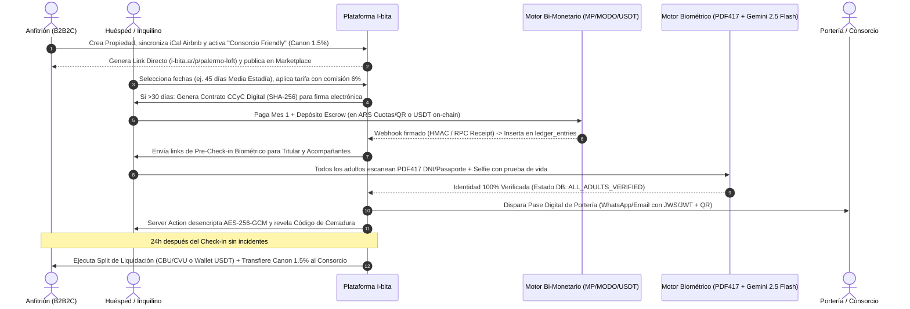
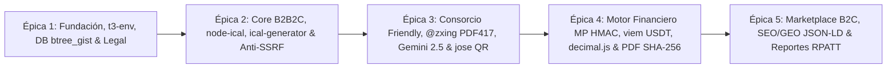

# Product Requirements Document (PRD): I-bita
**El Ecosistema Argentino de Alquileres Temporarios y Media Estadía (SaaS B2B2C + Marketplace B2C)**

---

## 0. Propósito del Documento y Trazabilidad

Este **Product Requirements Document (PRD v1.1.0)** define de forma exhaustiva las capacidades funcionales (**FR**), atributos de calidad y requerimientos no funcionales (**NFR**), flujos de usuario (**UJ**), reglas de negocio financieras/legales, la estructura de **Épicas priorizadas con sus Verification Gates**, el **Stack Open-Source Obligatorio** y la **Política Estricta Zero-Simulation** para construir el MVP de **I-bita**.

* **Audiencia:** Product Manager (`John`), UX Designer (`Sally`), System Architect (`Winston`), Senior Software Engineer (`Amelia`), QA Auditor y Stakeholders del negocio.
* **Documentos Base (Inputs):** Construido directamente sobre [docs/project-brief.md](file:///c:/Users/ALAN/.gemini/antigravity/scratch/I-bita/docs/project-brief.md) y su [addendum.md](file:///c:/Users/ALAN/.gemini/antigravity/scratch/I-bita/_bmad-output/planning-artifacts/briefs/brief-I-bita-2026-11-15/addendum.md).
* **Restricción Estricta de Hardware Local (Low-Footprint Architecture):** El entorno de desarrollo local corre sobre un procesador Intel Core i5 con recursos acotados de memoria RAM y disco. **Queda terminantemente prohibido levantar contenedores Docker pesados locales** (como microservicios self-hosted, modelos LLM/OCR locales o motores de bases de datos pesados en local). Toda la arquitectura se basa en paquetes NPM livianos ejecutados nativamente en **Next.js (Server Actions / Route Handlers)**, **Supabase Cloud** y **APIs Cloud**.

---

## 1. Visión del Producto y Estrategia de Ejecución

**I-bita** resuelve la desconexión crítica entre las plataformas globales de alojamiento (Airbnb, Booking) y la realidad financiera, consorcial y legal de la Argentina. En lugar de competir únicamente por volumen de anuncios genéricos, I-bita ofrece una infraestructura **Fintech + PropTech + Travel** basada en tres pilares:
1. **Motor Financiero Bi-Monetario y Split de Liquidación:** Cobros locales en **ARS** (Mercado Pago, MODO, Transferencias 3.0 con QR, y planes de 3 y 6 cuotas) para el público nacional, cobros en **USD / Stablecoins (USDT/USDC)** para extranjeros y nómadas digitales, y liquidación automatizada según la preferencia del Anfitrión (CBU/CVU en ARS o Wallet USDT).
2. **Módulo "Consorcio Friendly" (Zero-Trust Consorcial):** Eliminación del conflicto vecinal mediante validación biométrica obligatoria (**DNI/RENAPER y Pasaporte**) de **todos los huéspedes adultos declarados** antes de liberar las instrucciones de ingreso, envío automático de un **Pase Digital de Portería** por WhatsApp/Email a la seguridad del edificio y un **Micro-Canon Consorcial** opcional (1%–2% de cada reserva transferido al consorcio).
3. **Contratos Flexibles de Media Estadía (1 a 6 meses):** Captura del segmento de 30 a 180 días (estudiantes, tratamientos médicos, corporativo/Vaca Muerta y nómadas) con **comisión decreciente (5%–7%)**, contrato de locación temporaria digital automatizado bajo el Código Civil y Comercial Argentino (**CCyC Art. 1199**) y depósito en garantía protegido en custodia (**Escrow**).

Para escalar sin costo de adquisición prohibitivo, el producto se despliega bajo un **Go-To-Market Híbrido Secuencial**: primero habilita a los anfitriones actuales de Airbnb con un **Portal de Reserva Directa B2B2C** sincronizado vía **iCal**, y sobre ese inventario validado abre el **Marketplace Público B2C**.

---

## 2. Usuarios Objetivo y Flujos de Usuario (User Journeys)

### 2.1 Jobs To Be Done (JTBD)
* **Anfitrión / Property Manager (B2B2C):** *"Cuando un cliente recurrente o argentino me pide alquilar sin el recargo en dólares de Airbnb, o cuando el consorcio amenaza con prohibir los temporarios en el edificio, quiero un link de reserva directa sincronizado con mi calendario que cobre en pesos/cuotas o USDT, valide la identidad de todos los ocupantes y notifique automáticamente a la portería, para ganar más dinero y operar en paz con mis vecinos"*.
* **Huésped de Estadía Corta (Turista Nacional):** *"Cuando planeo una escapada o vacaciones en Argentina, quiero ver precios finales en Pesos Argentinos y pagar con Mercado Pago, MODO o en 3/6 cuotas sin percepciones cambiarias, teniendo certeza de que el alojamiento es real y seguro"*.
* **Inquilino de Media Estadía (1 a 6 meses — Corporativo / Salud / Estudiante / Nómada):** *"Cuando necesito mudarme temporalmente por 2 a 6 meses a CABA, Córdoba o Neuquén, quiero alquilar un departamento amoblado sin pagar un 18% de comisión turística ni necesitar garantía propietaria en la ciudad, firmando un contrato digital claro y dejando mi depósito protegido contra la inflación"*.
* **Seguridad / Administración del Consorcio:** *"Cuando ingresa un inquilino temporario al edificio, quiero recibir en el WhatsApp de la guardia o correo de la administración una credencial verificada con foto, DNI y fechas exactas antes de que llegue a la puerta, sin tener que tomar datos a mano ni discutir en el lobby"*.

### 2.2 No-Usuarios en v1.0 (Non-Users)
* **Buscadores de alquiler residencial tradicional a largo plazo (> 12 meses sin amoblar):** El motor contractual y tarifario de I-bita está diseñado para estadías de 1 noche a 180 días en unidades equipadas.
* **Hotelería tradicional de gran escala con sistemas PMS legacy cerrados:** El MVP prioriza departamentos, casas, cabañas y aparts gestionados por dueños directos o administradores profesionales con soporte iCal.

### 2.3 Flujos Principales de Usuario (Key User Journeys)



#### UJ-1: Onboarding B2B2C y Creación del Canal Directo + Consorcial
* **Protagonista y Contexto:** **Martín**, administrador de 18 departamentos en Palermo y Belgrano (CABA). Sufre presiones de dos consorcios por ingresos de huéspedes no registrados y pierde consultas diarias de argentinos que quieren pagar en cuotas.
* **Estado Inicial:** Ingresa a I-bita desde el navegador web, se registra con verificación de identidad y CUIT/CUIL.
* **Camino (Path):**
  1. Crea su primera **Unidad Funcional**, carga fotos, capacidad máxima (ej. 3 adultos) y pega el link **iCal** de su anuncio de Airbnb para sincronizar bloqueos cada 15 minutos.
  2. Configura su **Esquema Tarifario Dual**: precio base por noche ($50 USD o equivalente en ARS), descuento del 20% mensual para **Media Estadía (30–180 días)**, y su regla de **Split de Liquidación** (70% a su CVU en ARS y 30% a su Wallet USDT).
  3. Activa el **Módulo Consorcio Friendly**: carga el WhatsApp de la guardia del edificio, el email de la administración y habilita un **Micro-Canon Consorcial** del `1.5%` indicando el CBU/Alias del Consorcio.
* **Clímax:** En menos de 5 minutos obtiene su URL propia (`i-bita.ar/p/ugarteche-studio`) con el sello oficial *"Edificio Protegido — Consorcio Friendly"* lista para compartir por Instagram y WhatsApp.
* **Resolución:** Su unidad queda activa tanto para reservas directas B2B2C como indexada en el Marketplace B2C.

#### UJ-2: Reserva de Media Estadía con Contrato CCyC y Custodia Anti-Inflación
* **Protagonista y Contexto:** **Lucía**, médica residente de Mendoza que viaja a CABA por una rotación hospitalaria de **3 meses (90 días)** junto a su pareja.
* **Estado Inicial:** Entra desde su móvil al link directo de Martín o desde el buscador de I-bita filtrando por *"Media Estadía (1 a 6 meses)"*.
* **Camino (Path):**
  1. Selecciona 90 noches y declara **2 adultos**. El sistema aplica automáticamente el descuento mensual y reduce la comisión de servicio de I-bita al **6%**.
  2. Visualiza el plan de pagos mensualizado: **Mes 1 + Depósito en Garantía (Escrow)** equivalente a 1 mes, más el borrador pre-completado del **Contrato de Locación Temporaria (Art. 1199 CCyC)**.
  3. Firma electrónicamente el contrato desde su pantalla táctil y elige pagar el Mes 1 en **ARS con 3 cuotas vía Mercado Pago/MODO**, mientras constituye el depósito en garantía en **USDT (verificado on-chain vía `viem`)**.
* **Clímax:** Tras la confirmación del Webhook/RPC, recibe el contrato firmado y sellado con `SHA-256` en PDF y el calendario queda bloqueado automáticamente en I-bita y Airbnb.
* **Resolución:** La reserva pasa al estado `PENDING_BIOMETRIC_CHECKIN`, requiriendo que Lucía y su pareja completen su validación biométrica antes del ingreso.

#### UJ-3: Pre-Check-in "Zero-Trust Consorcial" y Pase Digital de Portería
* **Protagonista y Contexto:** **Lucía**, **su pareja (acompañante)** y **Jorge (encargado de seguridad del edificio)**, 24 horas antes del check-in.
* **Estado Inicial:** Reserva pagada; el código de cerradura/acceso está **cifrado en base de datos (`AES-256-GCM`) y retorna `null` en cualquier consulta de red** mientras no se cumpla la condición Zero-Trust.
* **Camino (Path):**
  1. Lucía abre el enlace de Pre-Check-in en la PWA móvil, escanea el código de barras **PDF417** del dorso de su DNI con `@zxing/browser`, captura el frente de su DNI y su selfie con prueba de vida validada contra **Gemini 2.5 Flash API**.
  2. Comparte por WhatsApp el link de acompañante a su pareja (`1 de 2 verificados — Acceso aún bloqueado a nivel servidor`).
  3. Su pareja completa el escaneo de DNI y selfie en 90 segundos (`2 de 2 verificados — Estado DB: ALL_ADULTS_VERIFIED`).
* **Clímax:** En el instante en que el segundo adulto queda validado:
  * **Jorge (Portería)** recibe en el WhatsApp de la guardia el **Pase Digital de Portería** firmado con `jose` (JWS/JWT) y su código QR generado con `qrcode` para verificación en vivo.
  * **Lucía** solicita las instrucciones de ingreso y el Server Action desencripta y entrega por primera vez el PIN de acceso.
* **Resolución:** Ingreso fluido en recepción sin fricciones; 24 horas después del check-in, I-bita libera automáticamente el pago del Mes 1 a Martín y transfiere el `1.5%` del Micro-Canon al Consorcio con su comprobante.

---

## 3. Glosario de Dominio (Glossary)

* **Anfitrión (Host / Property Manager):** Propietario individual o administrador profesional que publica una o más Unidades Funcionales en I-bita.
* **Huésped Titular:** Usuario mayor de 18 años que realiza la reserva, ejecuta el pago y suscribe el Contrato de Locación Temporaria.
* **Acompañante Declarado:** Todo ocupante adicional mayor de 18 años registrado en la reserva, sujeto a validación biométrica obligatoria bajo la regla Zero-Trust Consorcial.
* **Unidad Funcional (Propiedad):** Inmueble publicado en I-bita, vinculado opcionalmente a un Consorcio y sincronizado con calendarios externos.
* **Estadía Corta:** Reserva de entre `1 y 29 noches` con pago 100% al momento de reservar y comisión estándar de plataforma.
* **Media Estadía:** Reserva de entre `30 y 180 noches` con comisión decreciente (`5%–7%`), generación obligatoria de Contrato CCyC digital, cobro mensualizado y Depósito en Garantía en Escrow.
* **Split de Liquidación:** Regla automatizada que divide el monto cobrado (calculado con precisión exacta mediante `decimal.js` / `dinero.js`) entre la liquidación neta al Anfitrión (en CBU/CVU ARS o Wallet USDT), la comisión de I-bita y, si aplica, el Micro-Canon Consorcial.
* **Zero-Trust Consorcial:** Regla de arquitectura por la cual las instrucciones y el PIN de acceso físico al inmueble permanecen cifrados con `AES-256-GCM` y jamás viajan al cliente hasta que el 100% de los adultos declarados alcanzan el estado `ALL_ADULTS_VERIFIED` en PostgreSQL.
* **Pase Digital de Portería:** Credencial verificada con firma criptográfica JWS/JWT (`jose`) y código QR (`qrcode`) emitida tras superar el Zero-Trust Consorcial y enviada por WhatsApp/Email a la seguridad o administración del edificio.
* **Micro-Canon Consorcial:** Porcentaje opcional (`1% a 2%` del valor bruto de la estadía) que el Anfitrión destina automáticamente a la cuenta bancaria del Consorcio como incentivo de convivencia.
* **Depósito en Escrow (Custodia):** Fondo en garantía retenido durante una Media Estadía en moneda estable (USDT/USDC verificado on-chain con `viem`) o cuenta remunerada para evitar su licuación inflacionaria, liberado tras el check-out sin daños.

---

## 4. Especificación de Funcionalidades y Requerimientos Funcionales (FR)

### 4.1 Autenticación, Perfiles Multi-Rol y Módulo Legal Base
**Descripción:** Gestión de identidad de usuarios, control de acceso basado en roles (`Anfitrión`, `Huésped`, `Admin Consorcio`, `SuperAdmin I-bita`), validación de variables de entorno Fail-Fast (`@t3-oss/env-nextjs`) y cumplimiento normativo inicial. Realiza `UJ-1`, `UJ-2`, `UJ-3`.

* **FR-1: Registro y Autenticación Segura Multi-Rol**
  * **Capacidad:** El sistema debe permitir el registro e inicio de sesión mediante Email/Magic Link, Google OAuth y validación de teléfono celular (WhatsApp OTP) sobre Supabase Auth, asignando permisos granulares mediante Row-Level Security (RLS).
  * **Criterios de Aceptación (Verificables):**
    * Un usuario puede operar como `Huésped` y activar su perfil de `Anfitrión` tras completar la validación de CUIT/CUIL y datos de liquidación.
    * Las sesiones utilizan JWT firmados con rotación automática de refresh tokens y protección contra fuerza bruta (rate limit de 5 intentos/minuto por IP).
* **FR-2: Onboarding Fiscal y Bancario/Web3 del Anfitrión (KYB/KYC)**
  * **Capacidad:** El Anfitrión puede registrar y verificar sus cuentas de destino para el Split de Liquidación: `CBU/CVU` bancario/virtual en ARS y dirección de `Wallet USDT/USDC` (redes compatibles como Polygon/Arbitrum/Base).
  * **Criterios de Aceptación (Verificables):**
    * El sistema valida el formato y dígito verificador del CBU/CVU (22 dígitos) y el checksum EIP-55 de la dirección de billetera mediante `viem` (`isAddress`) antes de habilitar la publicación de propiedades.
* **FR-3: Módulo Legal Automático y Contacto Seguro (Por Default)**
  * **Capacidad:** El sistema debe incluir y renderizar de forma nativa las páginas de **Política de Privacidad** (cumplimiento Ley 25.326 de Protección de Datos Personales y consentimiento biométrico), **Términos y Condiciones** (mandato de cobro y locación temporaria CCyC), **Banner Interactivo de Consentimiento de Cookies** y **Módulo de Contacto Seguro** con validación frontend/backend (`zod`) y protección anti-spam.
  * **Criterios de Aceptación (Verificables):**
    * Ningún usuario puede iniciar el flujo de biometría sin aceptar explícitamente el consentimiento informado de tratamiento de datos biométricos.
    * El formulario de contacto sanitiza todos los inputs previniendo XSS/SQLi y persiste las consultas reales en Supabase.

---

### 4.2 Gestión de Propiedades, Sincronización iCal y Canal Directo B2B2C
**Descripción:** Herramientas para que el Anfitrión cree anuncios, sincronice disponibilidad con Airbnb/Booking en tiempo real usando `node-ical` e `ical-generator` con protección anti-SSRF, y obtenga su propio storefront de reserva directa (`i-bita.ar/p/[slug]`). Realiza `UJ-1`.

* **FR-4: Creación y Gestión de Unidades Funcionales**
  * **Capacidad:** El Anfitrión puede dar de alta propiedades especificando ubicación geográfica, fotos optimizadas, comodidades (incluyendo velocidad de Wi-Fi verificada para nómadas), capacidad máxima de adultos/menores, reglas de convivencia y código de cerradura/instrucciones de acceso (que se guardan inmediatamente cifradas en `AES-256-GCM`).
  * **Criterios de Aceptación (Verificables):**
    * Las imágenes subidas a Supabase Storage se sirven en formato `WebP/AVIF` con dimensionamiento explícito para evitar saltos visuales (`CLS = 0`).
* **FR-5: Sincronización Bidireccional de Calendarios vía iCal con Escudo Anti-SSRF**
  * **Capacidad:** El sistema importa calendarios `.ics` externos (Airbnb, Booking, Vrbo) en el servidor mediante `node-ical` tras validar la URL contra `ssrf-req-filter` / `ipaddr.js`, y exporta un endpoint `GET /api/ical/[propertyId].ics` generado con `ical-generator`.
  * **Criterios de Aceptación (Verificables):**
    * Cualquier intento de ingresar una URL iCal que apunte a `localhost`, `127.0.0.0/8`, `10.0.0.0/8`, `172.16.0.0/12`, `192.168.0.0/16` o `169.254.169.254` es rechazado inmediatamente con error de seguridad SSRF.
    * La ingesta soporta zonas horarias (`America/Argentina/Buenos_Aires`) y garantiza idempotencia por `UID` del evento RFC 5545.
* **FR-6: Generador de Link / Micrositio de Reserva Directa (B2B2C)**
  * **Capacidad:** Por cada Anfitrión y Unidad Funcional, el sistema genera una landing page dedicada de alta conversión (`i-bita.ar/p/{slug}` y portal de anfitrión `i-bita.ar/h/{host-slug}`) donde el Anfitrión puede ofrecer una tarifa preferencial directa.
  * **Criterios de Aceptación (Verificables):**
    * La página muestra un comparador matemático exacto de ahorro frente a plataformas internacionales y permite completar toda la reserva, pago, contrato y check-in biométrico sin salir del flujo.
* **FR-7: Motor Tarifario Dual con Precisión Decimal Exacta**
  * **Capacidad:** El Anfitrión puede fijar su tarifa base en `USD` o `ARS`, definir descuentos semanales/mensuales y activar tanto Estadía Corta (`1–29 noches`) como Media Estadía (`30–180 noches`). Todos los cálculos de tarifas, descuentos y comisiones se ejecutan con `decimal.js` o `dinero.js`.
  * **Criterios de Aceptación (Verificables):**
    * Cuando el Huésped selecciona `>= 30 noches`, el motor recalcula automáticamente la comisión de servicio de I-bita reduciéndola al tramo decreciente (`5%–7%`) y activa el esquema de cobro mensualizado más Depósito en Escrow sin errores de redondeo de punto flotante.

---

### 4.3 Módulo "Consorcio Friendly" (Biometría, Portería y Micro-Canon)
**Descripción:** Diferencial competitivo núcleo para destrabar edificios de propiedad horizontal mediante lectura PDF417 del DNI argentino (`@zxing/library`), contrastación biométrica con **Gemini 2.5 Flash API**, bloqueo criptográfico del PIN de acceso y emisión del Pase Digital de Portería firmado con `jose` + `qrcode`. Realiza `UJ-1`, `UJ-3`.

* **FR-8: Configuración del Perfil de Consorcio por Propiedad**
  * **Capacidad:** El Anfitrión puede asociar su Unidad Funcional a los datos de su edificio: nombre de la Administración, CUIT del Consorcio, teléfono WhatsApp de la Portería/Guardia, email de la Administración, y porcentaje opcional de **Micro-Canon Consorcial (`0%`, `1%`, `1.5%` o `2%`)** con su CBU/Alias de destino.
  * **Criterios de Aceptación (Verificables):**
    * Las propiedades que activan el Pase Digital de Portería y/o el Micro-Canon reciben visiblemente la insignia verificada **"Propiedad Consorcio Friendly"**.
* **FR-9: Flujo de Pre-Check-in Biométrico Multi-Huésped (PDF417 DNI / MRZ Pasaporte + Gemini 2.5 Flash)**
  * **Capacidad:** Tras confirmarse el pago de una reserva en el Ledger, el sistema genera enlaces únicos de verificación para el Huésped Titular y para cada Acompañante Declarado adulto. El flujo decodifica el código **PDF417** del dorso del DNI argentino usando `@zxing/library` / `@zxing/browser` (extrayendo Trámite, Apellido, Nombre, Sexo, DNI, Ejemplar, Fecha de Nacimiento y Emisión) y utiliza `@google/generative-ai` (**Gemini 2.5 Flash API**) con `zod` (*Structured Outputs*) en el servidor para contrastar los datos extraídos contra el frente del DNI/Pasaporte y la selfie del huésped.
  * **Criterios de Aceptación (Verificables):**
    * El validador estructurado verifica coincidencia facial y documental y actualiza el registro del huésped en PostgreSQL a `VERIFIED`.
    * Permite registrar opcionalmente la patente del vehículo con el que ingresarán a la cochera del edificio.
* **FR-10: Bloqueo Criptográfico de Acceso por Regla "Zero-Trust Consorcial"**
  * **Capacidad:** El PIN de cerradura e instrucciones sensibles de ingreso se almacenan cifrados (`AES-256-GCM`) y jamás se incluyen en respuestas JSON hacia el cliente mientras el estado de la reserva en PostgreSQL no sea `ALL_ADULTS_VERIFIED`.
  * **Criterios de Aceptación (Verificables):**
    * Cualquier consulta a la reserva cuando `count(adultos_verificados) < count(adultos_declarados)` devuelve `access_code: null` a nivel de red HTTP. Solo una Server Action / RPC invocada tras cumplirse `ALL_ADULTS_VERIFIED` desencripta y retorna el código.
* **FR-11: Emisión y Verificación Criptográfica del Pase Digital de Portería**
  * **Capacidad:** En el instante en que se cumple el `FR-10` (`ALL_ADULTS_VERIFIED`), el sistema firma un token JWS/JWT inmutable mediante `jose` con los datos de acceso, genera el código QR con `qrcode` apuntando a `i-bita.ar/verify/[token]` y envía el Pase vía **WhatsApp API** y **Email** a Portería y Administración.
  * **Criterios de Aceptación (Verificables):**
    * Al escanear el QR, la ruta pública `/verify/[token]` verifica la firma criptográfica con `jose` y muestra en tiempo real las fotos validadas de todos los adultos autorizados, DNI/Pasaporte, vigencia de la estadía y patente del vehículo.

---

### 4.4 Motor Financiero Bi-Monetario y Split de Liquidación
**Descripción:** Orquestación de pagos reales en ARS (`mercadopago` SDK oficial con validación HMAC) y Stablecoins USDT/USDC (`viem` con verificación on-chain de `getTransactionReceipt`), libro mayor inmutable (`ledger_entries`) y Split T+24h. Realiza `UJ-2`, `UJ-3`.

* **FR-12: Checkout Local en Pesos Argentinos (ARS) con SDK Oficial de Mercado Pago**
  * **Capacidad:** El Huésped puede abonar su reserva en ARS mediante el SDK oficial `mercadopago` (soportando saldo en cuenta, tarjetas en 1, 3 y 6 cuotas, MODO y Transferencias 3.0 con QR).
  * **Criterios de Aceptación (Verificables):**
    * El cambio de estado de la reserva a `PAID` ocurre **exclusivamente** cuando el endpoint `POST /api/webhooks/payments` recibe la notificación de Mercado Pago y valida criptográficamente el header `x-signature` usando `crypto.createHmac('sha256', MP_WEBHOOK_SECRET)`.
* **FR-13: Checkout Cripto (USDT / USDC) con Verificación On-Chain vía `viem`**
  * **Capacidad:** El Huésped o Nómada Digital puede abonar la reserva y/o constituir el Depósito en Escrow en **USDT o USDC** sobre redes compatibles de bajo costo (Polygon / Arbitrum / Base).
  * **Criterios de Aceptación (Verificables):**
    * El backend utiliza `viem` (`createPublicClient`, `getTransactionReceipt`, `parseEventLogs` del estándar ERC-20 `Transfer`) contra un nodo RPC real para comprobar que el hash de transacción existe, está confirmado en bloque, corresponde al contrato oficial de USDT/USDC y transfirió el monto exacto a la bóveda/wallet receptora antes de acreditar el pago.
* **FR-14: Libro Mayor Inmutable (`ledger_entries`) y Split de Liquidación T+24h**
  * **Capacidad:** Todo pago confirmado por Webhook/RPC inserta asientos contables de partida doble (calculados con `decimal.js` / `dinero.js`) en la tabla `ledger_entries` (protegida por RLS en modo *append-only*, bloqueando cualquier `UPDATE` o `DELETE`). Cumplidas 24 horas del Check-in biométrico sin incidentes, el motor liquida el neto al Anfitrión y el **Micro-Canon Consorcial (1%–2%)** al Consorcio.
  * **Criterios de Aceptación (Verificables):**
    * Uso estricto de `idempotency_key` única por evento de pago/liquidación; si el mismo webhook se recibe dos veces, el segundo intento se ignora sin duplicar asientos en `ledger_entries`.

---

### 4.5 Motor Legal de Media Estadía (Contratos CCyC y Escrow)
**Descripción:** Automatización contractual en PDF (`@react-pdf/renderer` o `pdf-lib`) sellada con `SHA-256`, cobro recurrente mensual y resguardo del depósito en garantía para estadías de 30 a 180 días. Realiza `UJ-2`.

* **FR-15: Generación en Servidor y Sellado SHA-256 de Contrato Temporario (CCyC Art. 1199)**
  * **Capacidad:** Para toda reserva de `30 a 180 noches`, el servidor genera un archivo PDF real del **Contrato de Locación Temporaria** usando `@react-pdf/renderer` o `pdf-lib` con los datos verificados de las partes, y calcula inmediatamente su hash criptográfico mediante `crypto.createHash('sha256').update(pdfBuffer).digest('hex')`.
  * **Criterios de Aceptación (Verificables):**
    * El binario PDF se almacena en Supabase Storage privado y su hash `SHA-256` de 64 caracteres hexadecimales se guarda en la tabla `contracts` junto con el timestamp y metadatos de firma electrónica de ambas partes.
* **FR-16: Gestión de Pagos Mensualizados y Depósito en Garantía en Custodia (Escrow)**
  * **Capacidad:** En reservas de Media Estadía (`> 30 días`), el sistema registra en `ledger_entries` el cobro del **Mes 1** más el **Depósito en Garantía en Escrow** (`ESCROW_HELD`), programando los vencimientos mensuales subsiguientes.
  * **Criterios de Aceptación (Verificables):**
    * Al finalizar la estadía (Check-out), la liberación o ejecución parcial del Escrow genera un nuevo asiento contable trazable en `ledger_entries`.

---

### 4.6 Marketplace Público B2C, Buscador Inteligente y Panel de Administración
**Descripción:** Superficie pública de descubrimiento de alojamientos optimizada para SEO/GEO/AEO, filtrado avanzado por tipo de estadía y panel de control operativo. Realiza `UJ-1`, `UJ-2`.

* **FR-17: Buscador B2C con Conmutador "Escapadas (Por Día)" vs. "Media Estadía (Por Mes)"**
  * **Capacidad:** Los usuarios pueden buscar propiedades en la base de datos real de Supabase por corredor geográfico (CABA, Costa Atlántica, Córdoba, Neuquén/Añelo), rango de fechas (filtrando unidades ocupadas en `bookings`), cantidad de huéspedes y alternar entre vista diaria o mensual, filtrando por insignias: *"Consorcio Friendly"*, *"Acepta Cuotas"*, *"Acepta USDT"* y *"Wi-Fi Verificado"*.
  * **Criterios de Aceptación (Verificables):**
    * Las páginas se pre-renderizan (SSR/ISR en Next.js) e inyectan datos estructurados `Schema.org / JSON-LD` dinámicos extraídos de Supabase.
* **FR-18: Panel de Control del Anfitrión y Exportación de Reportes Regulatorios**
  * **Capacidad:** El Anfitrión dispone de un dashboard alimentado en tiempo real por Supabase con calendario maestro, estado de pre-check-ins biométricos, movimientos en `ledger_entries`, comprobantes de Micro-Canon y exportación real de reportes en CSV/PDF compatibles con registros de alquileres temporarios (RPATT CABA / ARCA).
  * **Criterios de Aceptación (Verificables):**
    * El reporte descargado refleja exactamente las filas reales de reservas y huéspedes verificados del período filtrado.

---

## 5. Requerimientos No Funcionales (NFR) y Estándares de Excelencia

### 5.1 Velocidad Extrema, Core Web Vitals y Eficiencia en Hardware Local
* **NFR-1 (Métricas Core Web Vitals):** `LCP < 1.8s`, `INP < 150ms` y `CLS < 0.02` en conexiones móviles 4G.
* **NFR-2 (Arquitectura Cloud-Native Liviana para Desarrollo en Core i5):** Cero contenedores Docker pesados en local. Todo el procesamiento pesado (PostgreSQL + RLS + Storage en Supabase Cloud; inferencia multimodal en Gemini 2.5 Flash API; RPC en la nube para Web3) se delega a servicios cloud gestionados, manteniendo el consumo de RAM local de Next.js al mínimo indispensable.

### 5.2 Ciberseguridad Defensiva (OWASP & Zero Trust) y Privacidad Biométrica
* **NFR-3 (Validación Estricta de Entorno y Payloads):** Validación de variables de entorno en tiempo de build/arranque con `@t3-oss/env-nextjs` + `zod` (Fail-Fast) y validación de todos los inputs de usuario, webhooks y feeds iCal con `zod` y `ssrf-req-filter`.
* **NFR-4 (Protección de Datos Biométricos y PINs de Acceso):** Imágenes de DNI y selfies en buckets privados de Supabase Storage con `signed URLs <= 60s`. Códigos de cerradura cifrados con `AES-256-GCM` y protegidos a nivel servidor hasta cumplir `ALL_ADULTS_VERIFIED`.
* **NFR-5 (Cabeceras HTTP y Secretos):** `Content-Security-Policy (CSP)`, `Strict-Transport-Security (HSTS)`, `X-Frame-Options: DENY`, `X-Content-Type-Options: nosniff`.

### 5.3 Resiliencia, Concurrencia e Integridad Contable
* **NFR-6 (Prevención de Doble Reserva a Nivel Motor PostgreSQL):** Constraint de exclusión `EXCLUDE USING gist (property_id WITH =, daterange(check_in, check_out, '[)') WITH &&)` mediante la extensión `btree_gist` en PostgreSQL para impedir físicamente reservas superpuestas (`SQLSTATE 23P01`).
* **NFR-7 (Inmutabilidad Contable):** La tabla `ledger_entries` opera exclusivamente en modo *append-only*; las políticas RLS y triggers de PostgreSQL prohíben `UPDATE` y `DELETE` sobre cualquier asiento registrado.

### 5.4 UX/UI Mobile-First, Accesibilidad y SEO/GEO
* **NFR-8 (Mobile-First y PWA):** Flujos de Pre-Check-in Biométrico y Pase Digital de Portería optimizados para navegadores móviles sin instalación de app.
* **NFR-9 (Accesibilidad Universal y Temas):** Cumplimiento **WCAG 2.1 AA/AAA**, navegación por teclado, etiquetas `ARIA` y soporte **Dark/Light Mode**.
* **NFR-10 (SEO Técnico, GEO y AEO):** `sitemap.xml`, `robots.txt`, Open Graph dinámico y `JSON-LD` (`LodgingBusiness`, `Offer`, `FAQPage`).

---

## 6. No-Objetivos Explícitos (Non-Goals para el MVP v1.0)

1. **No se levantarán contenedores Docker locales ni modelos de IA locales:** Prohibido por restricción de hardware local (Core i5 / baja RAM y disco).
2. **No operará como ALyC propia para compra/venta de bonos USD MEP en v1.0:** Liquidación directa en ARS (CBU/CVU) o USDT (Wallet) según el canal procesado.
3. **No integrará hardware IoT físico (sensores de decibeles ni cerraduras electrónicas por API) en v1.0:** El bloqueo "Zero-Trust Consorcial" controla la desencriptación y revelación digital del PIN de acceso en servidor.
4. **No desarrollará apps nativas en tiendas (iOS/Android) en v1.0:** Se entrega como PWA Mobile-First sobre Next.js.

---

## 7. División del Producto en Épicas Ordenadas por Prioridad y Verification Gates

Cada Épica incluye su **Verification Gate (Requisito de Cierre en Terminal)** obligatorio antes de poder avanzar a la siguiente etapa.



### 🥇 Épica 1: Fundación Arquitectónica, Autenticación Multi-Rol, Base de Datos y Módulo Legal
* **Objetivo:** Establecer el cimiento "production-ready" en Next.js + Supabase Cloud + Vercel con validación Fail-Fast de variables de entorno (`@t3-oss/env-nextjs`), esquema PostgreSQL con RLS y `btree_gist`, autenticación multi-rol y módulos legales/contacto.
* **Requerimientos Cubiertos:** `FR-1`, `FR-2`, `FR-3`, `NFR-1` a `NFR-6`, `NFR-9`.
* **Entregables Clave:**
  1. Setup de proyecto Next.js (App Router, TypeScript estricto, Tailwind CSS, Dark/Light mode), validación `@t3-oss/env-nextjs` + `zod` y cabeceras de seguridad CSP/HSTS.
  2. Esquema PostgreSQL en Supabase Cloud (`profiles`, `properties`, `consortium_configs`, `bookings`, `guests_kyc`, `contracts`, `ledger_entries`) con políticas RLS y constraint `btree_gist` anti-solapamiento de fechas.
  3. Autenticación Supabase Auth y onboarding de Anfitrión con validación de CBU/CVU (22 dígitos) y checksum de Wallet USDT (`viem`).
  4. Header/Footer estratégicos, Módulo Legal Automático (Privacidad Ley 25.326, Términos CCyC, Banner de Cookies) y Formulario de Contacto Seguro conectado a Supabase.
* **🧪 Verification Gate (Requisito de Cierre en Terminal — Épica 1):**
  * Ejecución en consola de un script de prueba contra Supabase Cloud que inserte una reserva válida para una propiedad y acto seguido intente insertar una segunda reserva con un rango de fechas superpuesto para la misma propiedad, demostrando en la salida de terminal el error real de PostgreSQL **`23P01 (exclusion_violation)`** arrojado por el constraint `btree_gist`.

---

### 🥈 Épica 2: Core del Negocio B2B2C — Gestión de Propiedades, Sincronización iCal y Link de Reserva Directa
* **Objetivo:** Permitir a los anfitriones dar de alta propiedades, sincronizar calendarios bidireccionalmente con Airbnb/Booking mediante `node-ical` e `ical-generator` bajo protección anti-SSRF, y generar su página de reserva directa (`i-bita.ar/p/[slug]`).
* **Requerimientos Cubiertos:** `FR-4`, `FR-5`, `FR-6`, `FR-7`, `NFR-6`, `NFR-8`.
* **Entregables Clave:**
  1. ABM de Unidades Funcionales con subida real a Supabase Storage, cifrado `AES-256-GCM` del código de cerradura al guardar y calculadora tarifaria exacta con `decimal.js` / `dinero.js` (Estadía Corta vs. Media Estadía con comisión del `5%–7%`).
  2. Servicio de ingesta iCal en servidor con `node-ical` protegido con `ssrf-req-filter` / `ipaddr.js` y soporte de zona horaria `America/Argentina/Buenos_Aires`.
  3. Endpoint `GET /api/ical/[propertyId].ics` construido con `ical-generator` y Micrositio de Reserva Directa B2B2C.
* **🧪 Verification Gate (Requisito de Cierre en Terminal — Épica 2):**
  * Ejecución en terminal de un test automatizado que:
    1. Intente pasar `http://127.0.0.1:5432` y `http://169.254.169.254/latest/meta-data` al sincronizador iCal, demostrando el bloqueo inmediato por la capa Anti-SSRF antes de emitir la petición de red.
    2. Ejecute `curl -i http://localhost:3000/api/ical/[propertyId].ics` comprobando que responde `HTTP 200`, header `Content-Type: text/calendar; charset=utf-8` y cuerpo RFC 5545 válido (`BEGIN:VCALENDAR` ... `END:VCALENDAR`).

---

### 🥉 Épica 3: Módulo "Consorcio Friendly" — Pre-Check-in Biométrico Zero-Trust y Pase Digital de Portería
* **Objetivo:** Implementar la lectura del código PDF417 del DNI argentino (`@zxing/library`), la validación multimodal con **Gemini 2.5 Flash API**, la compuerta criptográfica Zero-Trust Consorcial para el código de cerradura y el Pase Digital de Portería firmado con `jose` + `qrcode`.
* **Requerimientos Cubiertos:** `FR-8`, `FR-9`, `FR-10`, `FR-11`, `NFR-4`, `NFR-8`.
* **Entregables Clave:**
  1. Configuración del Consorcio por propiedad (WhatsApp de portería, email de administración, CUIT y Micro-Canon `1%–2%`).
  2. Flujo móvil de Pre-Check-in con decodificación de código de barras **PDF417** (`@zxing/browser` / `@zxing/library`) y validación estructurada contra **Gemini 2.5 Flash API** (`@google/generative-ai` + `zod`).
  3. Compuerta Zero-Trust Consorcial: el código de acceso permanece cifrado y nulo en toda respuesta hasta que `count(adultos_declarados) == count(adultos_verificados)` (`ALL_ADULTS_VERIFIED`).
  4. Emisión del **Pase Digital de Portería** firmado con `jose` (JWS/JWT), generación de QR con `qrcode` y página pública de verificación en vivo `i-bita.ar/verify/[token]`.
* **🧪 Verification Gate (Requisito de Cierre en Terminal — Épica 3):**
  * Test de integración en consola que:
    1. Consulte el endpoint/Server Action de la reserva cuando falta verificar al menos un adulto declarado y demuestre que el campo del código de acceso devuelve estrictamente `null` a nivel de red.
    2. Complete la verificación del último adulto, genere el JWT del Pase de Portería con `jose` y verifique criptográficamente su firma y payload con la clave secreta real.

---

### 🏅 Épica 4: Motor Financiero Bi-Monetario, Split de Liquidación y Contratos de Media Estadía (CCyC)
* **Objetivo:** Implementar cobros reales en ARS con el SDK de `mercadopago` (validación HMAC en Webhook), cobros y custodia en USDT/USDC verificados on-chain con `viem`, libro mayor inmutable `ledger_entries` con precisión `decimal.js`/`dinero.js`, y generación de Contratos CCyC en PDF sellados con `SHA-256`.
* **Requerimientos Cubiertos:** `FR-12`, `FR-13`, `FR-14`, `FR-15`, `FR-16`, `NFR-6`, `NFR-7`.
* **Entregables Clave:**
  1. Checkout ARS con `mercadopago` SDK y Checkout Web3 USDT/USDC verificado en servidor mediante `viem` (`getTransactionReceipt`).
  2. Endpoint `POST /api/webhooks/payments` con validación `crypto.createHmac('sha256', secret)` e inserción append-only en `ledger_entries`.
  3. Generador de **Contrato de Locación Temporaria (Art. 1199 CCyC)** en servidor con `@react-pdf/renderer` o `pdf-lib` y sellado `SHA-256` (`crypto.createHash('sha256')`).
  4. Motor de Split de Liquidación T+24h y cálculo exacto de comisiones (5%–7% en Media Estadía) y Micro-Canon Consorcial (1%–2%) con `decimal.js` / `dinero.js`.
* **🧪 Verification Gate (Requisito de Cierre en Terminal — Épica 4):**
  * Ejecución en consola que:
    1. Envíe una petición `POST` a `/api/webhooks/payments` sin firma HMAC válida (o con firma alterada) y compruebe que responde `401 Unauthorized` sin tocar la base de datos.
    2. Genere un contrato PDF real en servidor para una reserva de Media Estadía, imprima en terminal su hash **`SHA-256` de 64 caracteres hexadecimales** y verifique el asiento correspondiente en `ledger_entries`.

---

### 🎖️ Épica 5: Marketplace Público B2C, Posicionamiento SEO/GEO/AEO y Panel de Gestión del Anfitrión
* **Objetivo:** Lanzar el buscador público B2C conectado en vivo a Supabase, inyectar metadatos `Schema.org / JSON-LD` para motores generativos y buscadores, y habilitar el dashboard del Anfitrión con exportación de reportes regulatorios (RPATT/ARCA).
* **Requerimientos Cubiertos:** `FR-17`, `FR-18`, `NFR-1`, `NFR-10`.
* **Entregables Clave:**
  1. Buscador público B2C con switch *"Por Día"* vs. *"Por Mes (Media Estadía)"* y filtros dinámicos sobre PostgreSQL.
  2. `sitemap.xml`, `robots.txt` y marcado `JSON-LD` dinámico en corredores y propiedades.
  3. Panel financiero del Anfitrión y exportador real de CSV/PDF para cumplimiento normativo.
* **🧪 Verification Gate (Requisito de Cierre en Terminal — Épica 5 y Gate Global Pre-Cierre):**
  * Ejecución obligatoria en terminal del escaneo de auditoría anti-simulación sobre todo el código fuente:
    ```bash
    grep -rniE "mock|simulate|dummy|fake|todo|fixme|setTimeout" src/
    ```
    El comando debe retornar **cero coincidencias de implementaciones falsas o simuladas**, acompañado de un `npm run build` exitoso sin errores de tipos ni lint.

---

## 8. Stack Open-Source Obligatorio por Módulo (Anti-Reinvención)

La arquitectura técnica (`docs/architecture.md`) y la implementación de código **DEBEN** utilizar exactamente las siguientes librerías open-source probadas en producción, ejecutadas nativamente en Node.js / Next.js sin requerir contenedores Docker pesados:

| Módulo / Épica | Paquete NPM Obligatorio | Repositorio de Referencia | Propósito Arquitectónico y Regla de Implementación |
| :--- | :--- | :--- | :--- |
| **Seguridad de Variables de Entorno (Épica 1)** | `@t3-oss/env-nextjs` + `zod` | `t3-oss/t3-env` | Validación estricta de esquemas de entorno en build y runtime. Si falta una API Key o secreto, la aplicación hace **Fail-Fast** inmediato. Prohibido usar `process.env.KEY \|\| "mock_key"`. |
| **Sincronización iCal — Ingesta (Épica 2)** | `node-ical` | `jens-maus/node-ical` | Parseo en servidor de feeds RFC 5545 reales de Airbnb/Booking con soporte de zona horaria `America/Argentina/Buenos_Aires` e idempotencia por `UID`. |
| **Sincronización iCal — Exportación (Épica 2)** | `ical-generator` | `sebbo2002/ical-generator` | Generación estándar RFC 5545 en `GET /api/ical/[propertyId].ics` respondiendo con `Content-Type: text/calendar; charset=utf-8`. |
| **Escudo Anti-SSRF (Épica 2)** | `ssrf-req-filter` / `ipaddr.js` | `azu/ssrf-req-filter` / `whitequark/ipaddr.js` | Validación previa de IP/DNS en toda URL de calendario ingresada por usuarios, bloqueando rangos privados (`127.0.0.0/8`, `10.0.0.0/8`, `169.254.169.254`, `localhost`). |
| **Lectura PDF417 DNI Argentino (Épica 3)** | `@zxing/library` + `@zxing/browser` | `zxing-js/library` | Decodificación del código de barras **PDF417** del dorso del DNI argentino para extraer la trama oficial RENAPER (Trámite, Apellido, Nombre, Sexo, DNI, Ejemplar, Fecha de Nacimiento y Emisión). |
| **Validación Biométrica y Documental (Épica 3)** | `@google/generative-ai` + `zod` *(y opcional `@vladmandic/human`)* | `google-gemini/generative-ai-js` / `vladmandic/human` | Contrastación multimodal en backend con **Gemini 2.5 Flash API** (*Structured Outputs*) entre la trama PDF417, la foto del frente del DNI/Pasaporte y la selfie con prueba de vida del huésped. |
| **Firma Criptográfica y QR de Portería (Épica 3)** | `jose` + `qrcode` | `panva/jose` + `soldair/node-qrcode` | Firma y verificación de tokens JWS/JWT sin dependencias nativas pesadas (`jose`) y renderizado del código QR verificable en tiempo real en `i-bita.ar/verify/[token]`. |
| **Pagos Locales en ARS (Épica 4)** | `mercadopago` | `mercadopago/sdk-nodejs` | Creación de preferencias de pago / órdenes y validación criptográfica obligatoria del header `x-signature` en el Webhook con `crypto.createHmac('sha256', secret)`. |
| **Pagos y Custodia USDT Web3 (Épica 4)** | `viem` | `wevm/viem` | Verificación en servidor de transacciones on-chain ERC-20 (USDT/USDC en Polygon/Arbitrum/Base) consultando el recibo real (`getTransactionReceipt`) por RPC antes de dar por acreditado un pago o Escrow. |
| **Precisión Financiera y Splits (Épica 4)** | `decimal.js` o `dinero.js` | `MikeMcl/decimal.js` / `dinerojs/dinero.js` | Aritmética decimal exacta de punto fijo/arbitrario. **Prohibido usar `number`/`float` nativo de JS** para calcular splits, comisiones del 5%–7%, Micro-Canon del 1%–2% o tipos de cambio. |
| **Contratos Legales CCyC en PDF (Épica 4)** | `@react-pdf/renderer` o `pdf-lib` + `crypto` | `diegomura/react-pdf` / `Hopding/pdf-lib` | Generación en servidor del binario PDF del contrato (Art. 1199 CCyC) seguido de sellado criptográfico con `crypto.createHash('sha256').update(pdfBuffer).digest('hex')`. |

---

## 9. Política Zero-Simulation y Contratos de Integración Real

Las siguientes reglas son **leyes inquebrantables de arquitectura y auditoría QA** para todo el repositorio de I-bita:

1. **Prohibición Absoluta de Mocks y Éxitos Falsos:**
   * Queda terminantemente prohibido utilizar `setTimeout` para simular llamadas de red, devolver JSONs estáticos hardcodeados, usar banderas booleanas en memoria (`let isVerified = true`) o implementar botones en la interfaz que muestren un *toast* de éxito sin haber persistido y validado la operación en Supabase Cloud o en el proveedor correspondiente.
2. **Protección Criptográfica del Código de Acceso (Épica 3 — Zero-Trust Consorcial):**
   * El PIN o código de cerradura de una Unidad Funcional se almacena cifrado con `AES-256-GCM` (usando el módulo nativo `node:crypto` o `pgcrypto`).
   * **Jamás** debe viajar en el payload JSON de una API hacia el navegador ni ocultarse visualmente con CSS (`display: none`, `filter: blur()`, etc.) mientras el estado de la reserva en PostgreSQL no sea `ALL_ADULTS_VERIFIED`.
   * La desencriptación solo ocurre en servidor dentro de una Server Action o función RPC de Supabase tras comprobar mediante consulta SQL que `count(adultos_declarados) == count(adultos_verificados)`.
3. **Mutación Financiera Exclusiva por Webhook/RPC Verificado (Épica 4):**
   * Ninguna reserva puede cambiar su estado a `PAID` ni `ESCROW_HELD` desde el cliente, ni mediante Server Actions disparadas por el retorno de una URL del navegador (`?status=approved`).
   * **Únicamente** el endpoint `POST /api/webhooks/payments` —tras verificar la firma HMAC-SHA256 de Mercado Pago para ARS o confirmar el recibo del bloque (`status === 'success'`) vía `viem` para USDT/USDC— tiene permisos (usando `SUPABASE_SERVICE_ROLE_KEY` en servidor) para insertar asientos en la tabla inmutable `ledger_entries` y transicionar el estado de la reserva.

---

## 10. Métricas de Éxito (Success Metrics) y Contra-Métricas

### Métricas Primarias
* **SM-1 (Conversión del Checkout Bi-Monetario):** Tasa de conversión de checkout `>= 4.5%` en links directos B2B2C gracias a la oferta de ARS en cuotas y USDT sin percepciones cambiarias (*Valida `FR-6`, `FR-12`, `FR-13`*).
* **SM-2 (Efectividad del Pre-Check-in Biométrico):** `>= 95%` de los huéspedes y acompañantes completan la verificación biométrica (PDF417 + Gemini 2.5 Flash) en `< 120 segundos` (*Valida `FR-9`, `FR-10`*).
* **SM-3 (Adopción del Sello Consorcio Friendly):** `>= 60%` de las unidades activas configuran el Pase Digital de Portería en sus primeros 30 días (*Valida `FR-8`, `FR-11`*).
* **SM-4 (Participación de Media Estadía):** `>= 35%` del GMV total proviniendo de reservas de 30 a 180 días con Contrato CCyC firmado y sellado con `SHA-256` (*Valida `FR-7`, `FR-15`, `FR-16`*).

### Contra-Métricas (No optimizar)
* **SM-C1 (Relajación del Zero-Trust Consorcial):** Nunca revelar el código de acceso si falta validar aunque sea 1 acompañante adulto declarado.
* **SM-C2 (Simulaciones o Fallbacks Silenciosos):** Cero tolerancia a fallbacks silenciosos ante falta de credenciales o errores de validación criptográfica.
