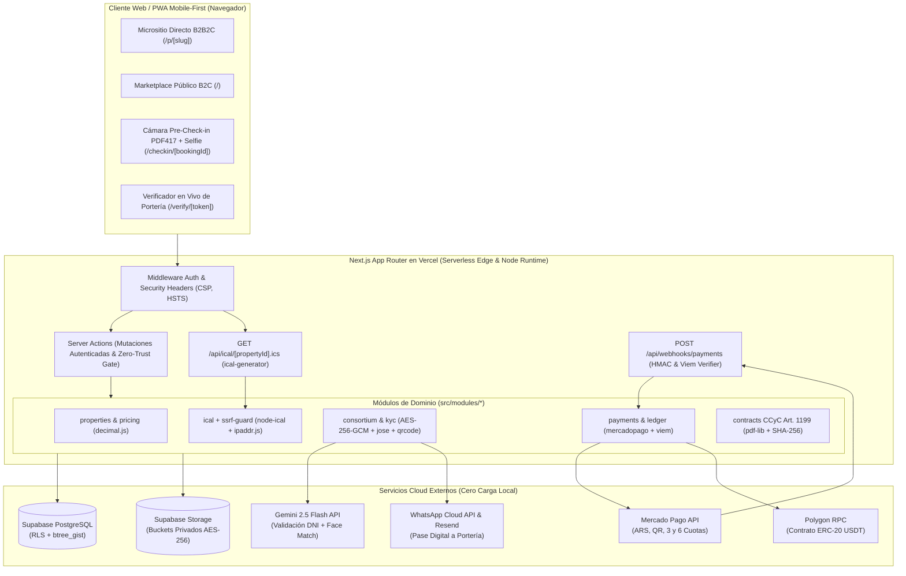
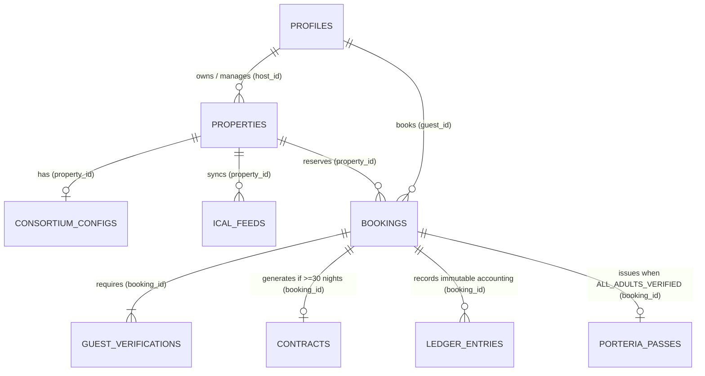

# Documento de Arquitectura Técnica: I-bita
**Plano de Ingeniería Full-Stack, Modelo de Datos PostgreSQL/RLS, Contratos de API, Seguridad Zero-Trust y Árbol del Proyecto**

---

## 1. Visión Arquitectónica y Paradigma de Diseño

**I-bita** se construye bajo el paradigma de **Monolito Modular Limpio con Puertos y Adaptadores (Clean Modular Monolith / Hexagonal Architecture)** sobre **Next.js (App Router)**, **Supabase Cloud** y **Vercel**.

### 1.1 Restricción de Hardware Local (Low-Footprint Architecture — `AD-1`)
Dado que la estación de trabajo de desarrollo cuenta con un procesador Intel Core i5 y recursos acotados de RAM y almacenamiento:
* **Cero Contenedores Pesados Locales:** Queda prohibido utilizar Docker Desktop para correr instancias locales de PostgreSQL, Redis, MinIO, motores OCR pesados o LLMs locales.
* **Ejecución 100% Cloud-Native y Liviana:**
  * **Base de Datos, Auth y Storage:** Conectados directamente al proyecto de **Supabase Cloud (`trknmgnzjhrhtwloiaga`)**.
  * **Inferencia Biométrica y Documental:** Ejecutada vía HTTP sobre **Google Gemini 2.5 Flash API** (`@google/generative-ai`) combinada con decodificación de código de barras PDF417 liviana(`@zxing/library`).
  * **Verificación Blockchain (USDT):** Consulta directa de recibos de transacción (`getTransactionReceipt`) mediante el cliente ultraliviano **`viem`** contra el nodo público HTTPS de Polygon (`https://polygon-bor-rpc.publicnode.com`).



---

## 2. Stack Tecnológico Definitivo y Matriz de Dependencias

Todas las librerías listadas son obligatorias (`PRD §8`) y reemplazan cualquier implementación casera o simulada:

| Capa | Tecnología / Paquete NPM | Versión | Propósito Técnico Exacto |
| :--- | :--- | :--- | :--- |
| **Framework Full-Stack** | `next`, `react`, `react-dom` | `^15.2.0` / `^19.0.0` | App Router, Server Components (SSR/ISR), Server Actions y Route Handlers. |
| **Lenguaje y Tipado** | `typescript` | `^5.8.0` | Modo estricto (`strict: true`, `noUncheckedIndexedAccess: true`). |
| **Estilos y UI** | `tailwindcss`, `lucide-react` | `^4.0.0` | Diseño Mobile-First, soporte Dark/Light Mode y cumplimiento WCAG 2.1 AAA. |
| **Validación de Entorno** | `@t3-oss/env-nextjs`, `zod` | `^0.12.0` / `^3.24.0` | **Fail-Fast** en `src/env.ts` si falta cualquier credencial en build/runtime (`AD-2`). |
| **Base de Datos y Auth** | `@supabase/supabase-js`, `@supabase/ssr`, `pg` | `^2.49.0` / `^0.6.0` / `^8.13.0` | Cliente RLS con cookies `HttpOnly`, cliente Admin para Webhooks y driver `pg` para migraciones/tests de consola. |
| **Sincronización iCal** | `node-ical`, `ical-generator` | `^0.20.0` / `^8.1.0` | Parseo RFC 5545 de Airbnb/Booking y generación de feed `.ics` propio. |
| **Seguridad Anti-SSRF** | `ipaddr.js`, `ssrf-req-filter` | `^2.2.0` / `^2.0.0` | Bloqueo de rangos de IP privados/loopback/link-local antes de `fetch()` en iCal (`AD-4`). |
| **Escaneo DNI Argentino** | `@zxing/library`, `@zxing/browser` | `^0.21.3` / `^0.1.5` | Decodificación del código de barras **PDF417** del dorso del DNI (trama oficial RENAPER). |
| **IA Biométrica Multimodal** | `@google/generative-ai` | `^0.24.0` | Verificación documental y facial con **Gemini 2.5 Flash** y salidas estructuradas Zod. |
| **Criptografía Portería** | `jose`, `qrcode` | `^6.0.0` / `^1.5.4` | Firma/verificación de tokens JWS/JWT (`HS256`) y generación de códigos QR para el Pase de Portería. |
| **Pasarela ARS** | `mercadopago` | `^2.5.0` | Creación de preferencias de pago en ARS (cuotas/QR) y consulta de pagos verificados. |
| **Pasarela Web3 (USDT)** | `viem` | `^2.23.0` | Validación de direcciones EIP-55 y verificación de `getTransactionReceipt` ERC-20 en Polygon. |
| **Precisión Matemática** | `decimal.js` | `^10.5.0` | Cálculos exactos de precios, comisiones decrecientes (`5%–7%`), Micro-Canon (`1%–2%`) y splits (`AD-6`). |
| **Contratos Legales PDF** | `pdf-lib` | `^1.17.1` | Generación en servidor de contratos temporarios (Art. 1199 CCyC) y sellado `SHA-256`. |

---

## 3. Modelo de Datos Relacional (PostgreSQL + RLS + `btree_gist`)

El esquema se despliega sobre **Supabase PostgreSQL (`trknmgnzjhrhtwloiaga`)**. Incluye las extensiones `pgcrypto` y `btree_gist`.

### 3.1 Diagrama Entidad-Relación (ERD)



### 3.2 Definición DDL Exacta (`supabase/migrations/0001_initial_schema_and_rls.sql`)

```sql
-- 1. Extensiones obligatorias
CREATE EXTENSION IF NOT EXISTS "pgcrypto";
CREATE EXTENSION IF NOT EXISTS "btree_gist";

-- 2. Enumeraciones de Dominio
CREATE TYPE user_role AS ENUM ('GUEST', 'HOST', 'CONSORTIUM_ADMIN', 'SUPERADMIN');
CREATE TYPE currency_code AS ENUM ('ARS', 'USD', 'USDT');
CREATE TYPE booking_status AS ENUM (
  'PENDING_PAYMENT',
  'PAID_PENDING_KYC',
  'ALL_ADULTS_VERIFIED',
  'CHECKED_IN',
  'COMPLETED',
  'CANCELLED',
  'EXPIRED',
  'ICAL_BLOCK'
);
CREATE TYPE kyc_status AS ENUM ('PENDING', 'VERIFIED', 'REJECTED');
CREATE TYPE ledger_entry_type AS ENUM (
  'GUEST_PAYMENT_ARS',
  'GUEST_PAYMENT_USDT',
  'ESCROW_DEPOSIT_HELD',
  'ESCROW_RELEASED',
  'PLATFORM_FEE_REVENUE',
  'CONSORTIUM_CANON_PAYABLE',
  'CONSORTIUM_CANON_PAID',
  'HOST_NET_PAYABLE',
  'HOST_NET_SETTLED'
);

-- 3. Tabla de Perfiles y Configuración de Liquidación del Anfitrión (FR-1, FR-2)
CREATE TABLE public.profiles (
  id UUID PRIMARY KEY REFERENCES auth.users(id) ON DELETE CASCADE,
  email TEXT NOT NULL UNIQUE,
  full_name TEXT NOT NULL,
  phone_whatsapp TEXT,
  role user_role NOT NULL DEFAULT 'GUEST',
  cuit_cuil VARCHAR(13),
  payout_cbu_cvu VARCHAR(22),
  payout_usdt_wallet VARCHAR(42),
  payout_split_ars_pct NUMERIC(5,2) NOT NULL DEFAULT 100.00 CHECK (payout_split_ars_pct BETWEEN 0 AND 100),
  created_at TIMESTAMPTZ NOT NULL DEFAULT NOW(),
  updated_at TIMESTAMPTZ NOT NULL DEFAULT NOW()
);

-- 4. Tabla de Unidades Funcionales / Propiedades (FR-4, FR-6, FR-7, AD-5)
CREATE TABLE public.properties (
  id UUID PRIMARY KEY DEFAULT gen_random_uuid(),
  host_id UUID NOT NULL REFERENCES public.profiles(id) ON DELETE RESTRICT,
  slug VARCHAR(120) NOT NULL UNIQUE,
  title TEXT NOT NULL,
  description TEXT NOT NULL,
  corridor VARCHAR(80) NOT NULL, -- Ej: 'CABA', 'COSTA_ATLANTICA', 'CORDOBA', 'VACA_MUERTA'
  address_line TEXT NOT NULL,
  unit_identifier VARCHAR(40) NOT NULL, -- Ej: 'Piso 4 Depto B'
  max_adults INT NOT NULL DEFAULT 2 CHECK (max_adults >= 1 AND max_adults <= 20),
  base_currency currency_code NOT NULL DEFAULT 'USD',
  nightly_rate NUMERIC(18,2) NOT NULL CHECK (nightly_rate > 0),
  monthly_discount_pct NUMERIC(5,2) NOT NULL DEFAULT 15.00 CHECK (monthly_discount_pct BETWEEN 0 AND 70),
  absorb_installments_cost BOOLEAN NOT NULL DEFAULT FALSE,
  accepts_usdt BOOLEAN NOT NULL DEFAULT TRUE,
  wifi_speed_mbps INT,
  images JSONB NOT NULL DEFAULT '[]'::jsonb,
  -- PIN/Instrucciones cifradas con AES-256-GCM (AD-5: Jamás expuestas en SELECT directo)
  access_code_ciphertext TEXT NOT NULL,
  access_code_iv TEXT NOT NULL,
  access_code_auth_tag TEXT NOT NULL,
  is_published BOOLEAN NOT NULL DEFAULT TRUE,
  created_at TIMESTAMPTZ NOT NULL DEFAULT NOW(),
  updated_at TIMESTAMPTZ NOT NULL DEFAULT NOW()
);

-- 5. Configuración "Consorcio Friendly" por Propiedad (FR-8)
CREATE TABLE public.consortium_configs (
  id UUID PRIMARY KEY DEFAULT gen_random_uuid(),
  property_id UUID NOT NULL UNIQUE REFERENCES public.properties(id) ON DELETE CASCADE,
  consortium_name TEXT NOT NULL,
  consortium_cuit VARCHAR(13),
  porteria_whatsapp VARCHAR(30) NOT NULL,
  admin_email TEXT NOT NULL,
  micro_canon_pct NUMERIC(4,2) NOT NULL DEFAULT 0.00 CHECK (micro_canon_pct IN (0.00, 1.00, 1.50, 2.00)),
  consortium_cbu_alias VARCHAR(60),
  active BOOLEAN NOT NULL DEFAULT TRUE,
  created_at TIMESTAMPTZ NOT NULL DEFAULT NOW()
);

-- 6. Calendarios Externos iCal (FR-5)
CREATE TABLE public.ical_feeds (
  id UUID PRIMARY KEY DEFAULT gen_random_uuid(),
  property_id UUID NOT NULL REFERENCES public.properties(id) ON DELETE CASCADE,
  source_name VARCHAR(50) NOT NULL DEFAULT 'Airbnb',
  feed_url TEXT NOT NULL,
  last_synced_at TIMESTAMPTZ,
  last_sync_status TEXT,
  created_at TIMESTAMPTZ NOT NULL DEFAULT NOW()
);

-- 7. Tabla de Reservas con Constraint Físico Anti-Solapamiento btree_gist (AD-3, NFR-6)
CREATE TABLE public.bookings (
  id UUID PRIMARY KEY DEFAULT gen_random_uuid(),
  property_id UUID NOT NULL REFERENCES public.properties(id) ON DELETE RESTRICT,
  guest_id UUID REFERENCES public.profiles(id) ON DELETE RESTRICT,
  check_in DATE NOT NULL,
  check_out DATE NOT NULL,
  nights_count INT GENERATED ALWAYS AS (check_out - check_in) STORED,
  is_mid_term BOOLEAN GENERATED ALWAYS AS ((check_out - check_in) >= 30) STORED,
  declared_adults_count INT NOT NULL DEFAULT 1 CHECK (declared_adults_count >= 1),
  verified_adults_count INT NOT NULL DEFAULT 0 CHECK (verified_adults_count >= 0),
  status booking_status NOT NULL DEFAULT 'PENDING_PAYMENT',
  payment_currency currency_code NOT NULL DEFAULT 'ARS',
  total_amount NUMERIC(18,6) NOT NULL DEFAULT 0,
  platform_fee_pct NUMERIC(5,2) NOT NULL DEFAULT 12.00,
  platform_fee_amount NUMERIC(18,6) NOT NULL DEFAULT 0,
  consortium_canon_amount NUMERIC(18,6) NOT NULL DEFAULT 0,
  host_net_amount NUMERIC(18,6) NOT NULL DEFAULT 0,
  escrow_deposit_usdt NUMERIC(18,6) NOT NULL DEFAULT 0,
  vehicle_plate VARCHAR(20),
  external_ical_uid TEXT UNIQUE,
  created_at TIMESTAMPTZ NOT NULL DEFAULT NOW(),
  updated_at TIMESTAMPTZ NOT NULL DEFAULT NOW(),
  CONSTRAINT check_valid_dates CHECK (check_out > check_in),
  -- INVARIANTE AD-3: PostgreSQL impide físicamente dos reservas activas superpuestas (SQLSTATE 23P01)
  CONSTRAINT no_overlapping_active_bookings EXCLUDE USING gist (
    property_id WITH =,
    daterange(check_in, check_out, '[)') WITH &&
  ) WHERE (status NOT IN ('CANCELLED', 'EXPIRED'))
);

-- 8. Verificaciones Biométricas de Huéspedes y Acompañantes (FR-9, FR-10)
CREATE TABLE public.guest_verifications (
  id UUID PRIMARY KEY DEFAULT gen_random_uuid(),
  booking_id UUID NOT NULL REFERENCES public.bookings(id) ON DELETE CASCADE,
  is_primary_guest BOOLEAN NOT NULL DEFAULT FALSE,
  invite_token UUID NOT NULL UNIQUE DEFAULT gen_random_uuid(),
  document_type VARCHAR(20) NOT NULL DEFAULT 'DNI_ARG', -- 'DNI_ARG' | 'PASSPORT'
  document_number VARCHAR(40),
  full_name_extracted TEXT,
  birth_date DATE,
  pdf417_raw_payload TEXT,
  dni_front_storage_path TEXT,
  selfie_storage_path TEXT,
  biometric_Confidence_score NUMERIC(5,2),
  gemini_audit_json JSONB,
  consent_accepted_at TIMESTAMPTZ,
  status kyc_status NOT NULL DEFAULT 'PENDING',
  verified_at TIMESTAMPTZ,
  created_at TIMESTAMPTZ NOT NULL DEFAULT NOW()
);

-- 9. Pases Digitales de Portería Emitidos (FR-11)
CREATE TABLE public.porteria_passes (
  id UUID PRIMARY KEY DEFAULT gen_random_uuid(),
  booking_id UUID NOT NULL UNIQUE REFERENCES public.bookings(id) ON DELETE CASCADE,
  jws_token TEXT NOT NULL,
  qr_data_url TEXT NOT NULL,
  sent_whatsapp_at TIMESTAMPTZ,
  sent_email_at TIMESTAMPTZ,
  revoked BOOLEAN NOT NULL DEFAULT FALSE,
  created_at TIMESTAMPTZ NOT NULL DEFAULT NOW()
);

-- 10. Contratos Temporarios CCyC Art. 1199 Sellados con SHA-256 (FR-15)
CREATE TABLE public.contracts (
  id UUID PRIMARY KEY DEFAULT gen_random_uuid(),
  booking_id UUID NOT NULL UNIQUE REFERENCES public.bookings(id) ON DELETE RESTRICT,
  stay_purpose VARCHAR(60) NOT NULL, -- 'TURISMO', 'ESTUDIO', 'TRATAMIENTO_MEDICO', 'CORPORATIVO_ENERGIA', 'NOMADA_DIGITAL'
  pdf_storage_path TEXT NOT NULL,
  pdf_sha256_hash CHAR(64) NOT NULL,
  guest_signed_at TIMESTAMPTZ,
  guest_signer_ip TEXT,
  host_signed_at TIMESTAMPTZ,
  created_at TIMESTAMPTZ NOT NULL DEFAULT NOW()
);

-- 11. Libro Mayor Contable Inmutable — Append-Only Ledger (FR-14, AD-6, NFR-7)
CREATE TABLE public.ledger_entries (
  id UUID PRIMARY KEY DEFAULT gen_random_uuid(),
  booking_id UUID NOT NULL REFERENCES public.bookings(id) ON DELETE RESTRICT,
  idempotency_key VARCHAR(140) NOT NULL UNIQUE,
  entry_type ledger_entry_type NOT NULL,
  currency currency_code NOT NULL,
  amount NUMERIC(18,6) NOT NULL,
  external_reference TEXT NOT NULL, -- ID de pago Mercado Pago o TxHash de Polygon
  metadata JSONB NOT NULL DEFAULT '{}'::jsonb,
  created_at TIMESTAMPTZ NOT NULL DEFAULT NOW()
);

-- Trigger de Inmutabilidad Absoluta en ledger_entries (Prohibido UPDATE y DELETE)
CREATE OR REPLACE FUNCTION public.prevent_ledger_mutation()
RETURNS TRIGGER AS $$
BEGIN
  RAISE EXCEPTION 'LEDGER_IMMUTABLE_VIOLATION: La tabla ledger_entries es estrictamente append-only (prohibido %)', TG_OP
    USING ERRCODE = '42501';
END;
$$ LANGUAGE plpgsql;

CREATE TRIGGER trg_ledger_immutable
BEFORE UPDATE OR DELETE ON public.ledger_entries
FOR EACH ROW EXECUTE FUNCTION public.prevent_ledger_mutation();

-- 12. Consultas del Módulo de Contacto Seguro (FR-3)
CREATE TABLE public.contact_inquiries (
  id UUID PRIMARY KEY DEFAULT gen_random_uuid(),
  full_name TEXT NOT NULL,
  email TEXT NOT NULL,
  phone TEXT,
  subject TEXT NOT NULL,
  message TEXT NOT NULL,
  created_at TIMESTAMPTZ NOT NULL DEFAULT NOW()
);
```

### 3.3 Políticas de Seguridad Row-Level Security (RLS)
* Todas las tablas tienen `ALTER TABLE ... ENABLE ROW LEVEL SECURITY;`.
* **`properties`:** Lectura pública de columnas descriptivas (`SELECT` para anuncios publicados), pero las columnas sensibles `access_code_ciphertext`, `access_code_iv` y `access_code_auth_tag` solo son legibles por el `host_id` propietario o por el cliente Admin de servidor dentro de la compuerta Zero-Trust.
* **`ledger_entries`:** Solo lectura para el `host_id` dueño de la propiedad de la reserva o el `guest_id` titular; inserción permitida **exclusivamente** al rol `service_role` desde el Webhook/RPC verificado.

---

## 4. Contratos de API, Server Actions y Flujos Criptográficos

### 4.1 Contrato de Respuesta Unificado
Toda Server Action y Route Handler devuelve una estructura determinista:
```typescript
export type ActionResult<T> =
  | { ok: true; data: T }
  | { ok: false; error: { code: ErrorCode; message: string; details?: unknown } };
```

### 4.2 Endpoints HTTP Públicos y Webhooks (`src/app/api/*`)

| Método y Ruta | Entrada / Headers | Procesamiento en Servidor | Salida |
| :--- | :--- | :--- | :--- |
| **`GET /api/ical/[propertyId].ics`** | `propertyId` (UUID) | Consulta reservas activas en `public.bookings` para la propiedad y construye el calendario RFC 5545 usando `ical-generator` con zona `America/Argentina/Buenos_Aires`. | `200 OK` con `Content-Type: text/calendar; charset=utf-8`. |
| **`POST /api/webhooks/payments`** | Header `x-signature` (Mercado Pago) o JSON `{ provider: 'POLYGON_USDT', bookingId, txHash }` | **Rama ARS:** Extrae `ts` y `v1` de `x-signature`, computa `crypto.createHmac('sha256', env.MP_WEBHOOK_SECRET)` sobre el manifest `id:[data.id];request-id:[x-request-id];ts:[ts];`. Si no coincide, retorna `401 Unauthorized`. Si coincide, consulta el pago con SDK `mercadopago` e inserta en `ledger_entries`.<br>**Rama USDT:** Invoca `viem.getTransactionReceipt({ hash: txHash })` contra `env.EVM_RPC_URL`, verifica evento `Transfer` en el contrato `env.NEXT_PUBLIC_USDT_CONTRACT_ADDRESS` hacia `env.NEXT_PUBLIC_IBITA_TREASURY_WALLET` e inserta en `ledger_entries`. | `200 OK` `{ ok: true, ledgerEntryId }` o `401/422` en fallo de verificación. |

### 4.3 Server Actions Críticas por Dominio

1. **`syncExternalIcalAction(propertyId, feedUrl)` (`src/modules/ical/actions.ts`):**
   * Pasa `feedUrl` por `assertSafeExternalUrl(feedUrl)` (`ipaddr.js` + resolución DNS). Si apunta a `127.0.0.1`, `localhost`, `10.x.x.x`, `192.168.x.x` o `169.254.169.254`, lanza `SSRF_BLOCKED_ERROR`.
   * Descarga y parsea eventos con `node-ical`, insertando bloqueos idempotentes por `external_ical_uid`.
2. **`verifyGuestBiometricsAction(inviteToken, formData)` (`src/modules/consortium/actions.ts`):**
   * Recibe la trama decodificada del código PDF417 del DNI (`@zxing/library`), la imagen del frente del DNI y la selfie capturada.
   * Sube las imágenes al bucket privado `kyc-documents` en Supabase Storage.
   * Invoca **Gemini 2.5 Flash** (`@google/generative-ai`) con esquema `zod` para auditar que el rostro de la selfie corresponde a la foto del DNI y que los datos del frente coinciden con la trama PDF417.
   * Si aprueba (`score >= 90`), marca el registro en `guest_verifications` como `VERIFIED` e incrementa `bookings.verified_adults_count`.
   * Si `verified_adults_count == declared_adults_count`, cambia `bookings.status = 'ALL_ADULTS_VERIFIED'`, firma el token JWS con `jose` (`env.PORTERIA_JWS_SECRET`), genera el QR con `qrcode` y despacha el Pase Digital a Portería vía WhatsApp Cloud API y Resend Email.
3. **`getBookingAccessDetailsAction(bookingId)` (`src/modules/consortium/actions.ts`):**
   * Verifica en PostgreSQL el estado de la reserva.
   * **Si `status !== 'ALL_ADULTS_VERIFIED'`:** Devuelve `{ ok: true, data: { status, verifiedAdults, declaredAdults, accessCode: null } }`. El PIN jamás viaja por la red.
   * **Si `status === 'ALL_ADULTS_VERIFIED'`:** Desencripta en memoria del servidor `access_code_ciphertext` usando `node:crypto` (`createDecipheriv('aes-256-gcm', key, iv)`) y entrega el PIN al huésped verificado.
4. **`generateAndSignContractAction(bookingId, signatureData)` (`src/modules/contracts/actions.ts`):**
   * Genera el PDF del Contrato de Locación Temporaria (Art. 1199 CCyC) con `pdf-lib`, calcula `const sha256 = crypto.createHash('sha256').update(pdfBytes).digest('hex')`, sube el PDF a Supabase Storage y registra la fila en `public.contracts`.

---

## 5. Estrategia de Autenticación, Autorización y Seguridad (OWASP)

* **Sesiones SSR Seguras:** Implementadas con `@supabase/ssr` en `src/middleware.ts`, refrescando el token JWT en cookies `HttpOnly`, `Secure`, `SameSite=Lax`.
* **Cabeceras de Seguridad HTTP (`next.config.ts`):**
  * `Strict-Transport-Security: max-age=63072000; includeSubDomains; preload`
  * `X-Frame-Options: DENY`
  * `X-Content-Type-Options: nosniff`
  * `Referrer-Policy: strict-origin-when-cross-origin`
  * `Content-Security-Policy` restrictiva permitiendo conexiones solo a Supabase (`*.supabase.co`), Mercado Pago, Polygon RPC y Google Gemini.
* **Cifrado de Secretos Físicos (`AES-256-GCM`):**
  * Módulo `src/lib/crypto/aes-gcm.ts` utilizando `Buffer.from(env.ACCESS_CODE_ENCRYPTION_KEY, 'hex')` (32 bytes), vector de inicialización aleatorio de 12 bytes (`crypto.randomBytes(12)`) y tag de autenticación de 16 bytes por cada propiedad.

---

## 6. Manejo Defensivo de Errores y Resiliencia

Todos los errores de negocio e infraestructura heredan de `AppError` (`src/lib/errors/app-error.ts`) con códigos tipados:
* `ENV_VALIDATION_ERROR` (500 — Fail-Fast en arranque)
* `BOOKING_OVERLAP_CONFLICT` (409 — Mapeado directamente desde PostgreSQL `SQLSTATE 23P01` de `btree_gist`)
* `SSRF_BLOCKED_ERROR` (422 — Intento de lectura de IP interna/privada en iCal)
* `ZERO_TRUST_ACCESS_LOCKED` (403 — Intento de revelar código de cerradura con acompañantes pendientes de biometría)
* `WEBHOOK_SIGNATURE_INVALID` (401 — Firma HMAC-SHA256 de Mercado Pago inválida o ausente)
* `ONCHAIN_RECEIPT_INVALID` (422 — Hash de transacción USDT inexistente, revertido o monto insuficiente en `viem`)
* `LEDGER_IMMUTABILITY_ERROR` (403 — Intento ilegal de `UPDATE` o `DELETE` sobre `ledger_entries`)

---

## 7. Árbol Exacto de Directorios del Proyecto

```text
c:/Users/ALAN/.gemini/antigravity/scratch/I-bita/
├── .env.example                           # Plantilla documentada de variables de entorno
├── .env.local                             # Credenciales reales activas (gitignored)
├── .gitignore
├── next.config.ts                         # Headers OWASP (CSP, HSTS, X-Frame-Options) e imágenes WebP/AVIF
├── package.json
├── tsconfig.json
├── docs/
│   ├── project-brief.md                   # Product Brief oficial
│   ├── prd.md                             # PRD v1.1.0 con Zero-Simulation y Verification Gates
│   └── architecture.md                    # Este plano técnico de arquitectura
├── supabase/
│   └── migrations/
│       └── 0001_initial_schema_and_rls.sql # DDL completo con btree_gist, RLS y trigger append-only
├── scripts/
│   └── gates/                             # Scripts ejecutables en consola para los 5 Verification Gates
│       ├── gate-epic-1-btree-gist.ts
│       ├── gate-epic-2-ical-ssrf.ts
│       ├── gate-epic-3-zero-trust-kyc.ts
│       ├── gate-epic-4-webhook-pdf-ledger.ts
│       └── gate-epic-5-zero-simulation.ts
└── src/
    ├── env.ts                             # Validación Fail-Fast con @t3-oss/env-nextjs + zod
    ├── middleware.ts                      # Sesión @supabase/ssr y protección de rutas
    ├── lib/
    │   ├── supabase/
    │   │   ├── client.ts                  # Browser client (anon key + RLS)
    │   │   ├── server.ts                  # Server Component / Action client (cookies)
    │   │   └── admin.ts                   # Service Role client (exclusivo para Webhooks/Ledger y Gate scripts)
    │   ├── crypto/
    │   │   ├── aes-gcm.ts                 # Cifrado/Desencriptación AES-256-GCM de PINs de cerraduras
    │   │   └── porteria-jws.ts            # Firma y verificación de tokens JWS/JWT con `jose` + `qrcode`
    │   ├── math/
    │   │   └── money.ts                   # Calculadora financiera exacta con `decimal.js`
    │   └── errors/
    │       └── app-error.ts               # Catálogo de errores tipados y mapeo SQLSTATE
    ├── modules/
    │   ├── auth/                          # Onboarding Anfitrión (validador CBU 22 dígitos + viem isAddress)
    │   ├── properties/                    # ABM Unidades Funcionales y motor de tarifas (Corta vs Media Estadía)
    │   ├── ical/                          # Ingesta `node-ical`, exportación `ical-generator` y `ssrf-guard.ts`
    │   ├── consortium/                    # Escáner PDF417 `@zxing`, auditor Gemini 2.5 Flash, Zero-Trust Gate y Pase QR
    │   ├── payments/                      # SDK `mercadopago`, verificador HMAC, `viem` Polygon USDT y Split Ledger
    │   ├── contracts/                     # Generador PDF CCyC Art. 1199 (`pdf-lib`) y sellado `SHA-256`
    │   └── marketplace/                   # Buscador B2C, filtros SQL, generador JSON-LD y reportes RPATT/ARCA
    ├── components/
    │   ├── layout/                        # Header sticky, Footer, ThemeToggle (Dark/Light), CookieConsentBanner
    │   ├── ui/                            # Sistema de diseño accesible WCAG 2.1 AAA
    │   ├── booking/                       # Calculadora interactiva bi-monetaria (ARS cuotas / USDT)
    │   └── kyc/                           # Lector de cámara PDF417 DNI y captura de selfie en vivo
    └── app/
        ├── layout.tsx
        ├── page.tsx                       # Home Marketplace B2C (Switch Por Día vs Media Estadía 1-6 meses)
        ├── sitemap.ts                     # Generación dinámica de sitemap.xml
        ├── robots.ts                      # Generación dinámica de robots.txt
        ├── (public)/
        │   ├── legal/
        │   │   ├── privacidad/page.tsx    # Política de Privacidad (Ley 25.326 y Biometría)
        │   │   └── terminos/page.tsx      # Términos y Condiciones (CCyC Art. 1199 y Mandato de Split)
        │   └── contacto/page.tsx          # Módulo de Contacto Seguro validado con Zod
        ├── p/
        │   └── [slug]/page.tsx            # Micrositio B2B2C de Reserva Directa por Propiedad
        ├── checkin/
        │   └── [bookingId]/page.tsx       # Flujo de Pre-Check-in Biométrico Zero-Trust y revelación de PIN
        ├── verify/
        │   └── [token]/page.tsx           # Vista pública en vivo para Guardia/Portería al escanear el QR
        ├── dashboard/
        │   └── page.tsx                   # Panel del Anfitrión (Propiedades, iCal, Ledger, Contratos y CSV RPATT)
        └── api/
            ├── ical/
            │   └── [propertyId]/route.ts  # Endpoint RFC 5545 (.ics)
            └── webhooks/
                └── payments/route.ts      # Receptor HMAC Mercado Pago y verificador on-chain Viem
```
